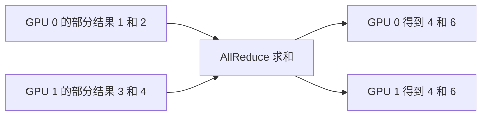

# 第一课 为什么大模型需要 AllReduce

本课回答一个问题：**一个线性层被拆给两张 GPU 后，为什么每张卡算完自己的部分，还没有得到完整答案？**

代码：[01_allreduce.py](01_allreduce.py)。实测日志：[01_tokenspeed.log](logs/01_tokenspeed.log)。[返回教程入口](README.md)。

## 1 从一个可以手算的线性层开始

大模型里有很多线性层。先省略偏置，把一层写成：

$$
y = Wx
$$

$x$ 是输入数字组成的向量，$W$ 是模型权重矩阵，$y$ 是输出。我们选一个很小的例子：

$$
W = \begin{bmatrix}1 & 0 & 1 & 0 \\ 0 & 1 & 0 & 1\end{bmatrix},
\qquad
x = \begin{bmatrix}1 \\ 2 \\ 3 \\ 4\end{bmatrix}
$$

$$
\begin{aligned}
y_0 &= 1\times 1 + 0\times 2 + 1\times 3 + 0\times 4 = 4, \\
y_1 &= 0\times 1 + 1\times 2 + 0\times 3 + 1\times 4 = 6, \\
y &= \begin{bmatrix}4 \\ 6\end{bmatrix}.
\end{aligned}
$$

如果一张 GPU 负责全部计算，它自己就可以得到 `[4, 6]`。

大模型可能需要把同一个线性层的权重分到多张卡上，以分担存储和计算。**多卡不一定更快，因为分工之后还会产生通信成本。**

## 2 按输入维度拆给两张 GPU

让 GPU 0 处理输入的前两个数字，GPU 1 处理后两个数字。权重也沿对应的输入维度拆开：

$$
W_0 = W_1 = \begin{bmatrix}1 & 0 \\ 0 & 1\end{bmatrix},
\qquad
x_0 = \begin{bmatrix}1 \\ 2\end{bmatrix},
\qquad
x_1 = \begin{bmatrix}3 \\ 4\end{bmatrix}
$$

$$
W_0x_0 = \begin{bmatrix}1 \\ 2\end{bmatrix},
\qquad
W_1x_1 = \begin{bmatrix}3 \\ 4\end{bmatrix}
$$

两张卡得到的都是对同一个输出向量的**部分贡献**。完整结果是：

$$
y = W_0x_0 + W_1x_1
  = \begin{bmatrix}1 \\ 2\end{bmatrix}
  + \begin{bmatrix}3 \\ 4\end{bmatrix}
  = \begin{bmatrix}4 \\ 6\end{bmatrix}
$$

这就需要把两个部分结果逐元素相加。每张 GPU 有自己的显存；即使两张卡之间有 NVLink，也不会自动把两个张量相加。



图中的中间方框表示一个通信操作，不是说实际运行一定经过某个中心节点。NCCL 会选择具体通信算法。

这里采用按输入维度切分的方式，所以需要求和。换成其他切分方式，可能需要拼接，也可能暂时保持分片；不能把“多卡计算”一概理解为“做一次求和”。

## 3 AllReduce 的名字是什么意思

`Reduce` 表示把多个参与者的数据按某个规则合并，本例的规则是 `SUM`，即逐元素相加。`All` 表示通信组里的**每个参与者都得到合并后的完整结果**。

| 参与者 | 通信前 | AllReduce SUM 后 |
| --- | --- | --- |
| GPU 0 对应进程 | `[1, 2]` | `[4, 6]` |
| GPU 1 对应进程 | `[3, 4]` | `[4, 6]` |

注意结果是求和，不是平均。AllReduce 也有其他归约规则，本课只使用 SUM。

## 4 启动程序并对照真实输出

```bash
cd /home/hadoop-scale-llm/dasc
bash tokenspeed_learning/run_lesson_01.sh
```

2026 年 11 月 23 日，本机实际运行结果如下，与 [原始日志](logs/01_tokenspeed.log) 一致：

```text
rank=0, local_rank=0, GPU=NVIDIA H20-3e
  自己算出的部分结果: [1.0, 2.0]
  AllReduce(SUM) 后:  [4.0, 6.0]
  完整矩阵参考答案:   [4.0, 6.0]
rank=1, local_rank=1, GPU=NVIDIA H20-3e
  自己算出的部分结果: [3.0, 4.0]
  AllReduce(SUM) 后:  [4.0, 6.0]
  完整矩阵参考答案:   [4.0, 6.0]
PASS: api=tokenspeed，两张卡都得到完整答案 [4.0, 6.0]
```

逐项解读：

- `rank=0` 和 `rank=1` 是两个进程的全局编号。本例每个进程控制一张 GPU。
- `自己算出的部分结果` 是通信前的本地矩阵乘法结果，所以两张卡不同。
- `AllReduce(SUM) 后` 是通信后的结果，两张卡都得到完整的 `[4, 6]`。
- `完整矩阵参考答案` 是直接计算完整 `W @ x` 的结果，用来核对答案。
- `PASS` 表示程序的数值断言通过，不只是程序没有报错。

为便于核对，教学代码在每张卡上都构造了完整的小矩阵，然后选取对应部分计算。真实权重分片通常在加载阶段就完成。因此本练习展示的是分片计算和通信的关系，不是显存节省测试。

## 5 按执行顺序看代码

### 第一步 torchrun 启动两个进程

[启动脚本](run_lesson_01.sh) 先加载环境，然后执行：

```bash
python -u -m torch.distributed.run --standalone --nnodes=1 --nproc-per-node=2 \
    /home/hadoop-scale-llm/dasc/tokenspeed_learning/01_allreduce.py --api tokenspeed
```

这个命令由脚本执行即可，不需要重复执行。`--nnodes=1` 表示一台机器，`--nproc-per-node=2` 表示启动两个进程。两个进程执行的是**同一份 Python 文件**，通过自己的编号选择不同的数据。

### 第二步 读取编号并选择 GPU

```python
rank = int(os.environ["RANK"])
local_rank = int(os.environ["LOCAL_RANK"])
world_size = int(os.environ["WORLD_SIZE"])
torch.cuda.set_device(local_rank)
```

| 名称 | 含义 | 本次两个进程的值 |
| --- | --- | --- |
| `RANK` | 整个分布式任务中的进程编号 | 0、1 |
| `LOCAL_RANK` | 当前机器内的进程编号 | 0、1 |
| `WORLD_SIZE` | 整个任务的进程总数 | 都是 2 |

rank 是进程编号，不是 GPU 的硬件编号。本例采用“一进程一张可见 GPU”的映射，所以用 `local_rank` 选择 CUDA 设备。

### 第三步 建立通信组

```python
dist.init_process_group("nccl", timeout=timedelta(seconds=60), device_id=device)
```

通信组定义哪些进程一起参加操作。本例用 NCCL 后端建立包含两个进程的默认组。这里的 60 秒是进程组操作的超时设置，不是整个程序的运行时长限制。

### 第四步 每个进程只计算自己的部分

```python
begin, end = rank * 2, (rank + 1) * 2
partial = weight[:, begin:end] @ x[begin:end]
before = partial.clone()
```

rank 0 选择输入下标 `0:2`，rank 1 选择 `2:4`。冒号切片不包含右端点。`before` 保留通信前的副本，方便之后打印对比。

### 第五步 通过 TokenSpeed 做 AllReduce

```python
group = tuple(range(world_size))  # 本例是 (0, 1)
process_group_manager.register_process_group("nccl", group, dist.group.WORLD)
backend = NcclBackend()
backend.configure(use_pynccl=False)
result = backend.all_reduce(partial, group, op=dist.ReduceOp.SUM)
```

第一行列出通信参与者。第二行把已经建立好的 PyTorch 进程组登记给 TokenSpeed。随后调用 TokenSpeed 的 NCCL 后端。

本次配置通过 `torch.distributed` 使用 NCCL。这个 AllReduce 路径会原地修改 `partial`，所以前面用 `clone()` 保留了旧值。

**组内两个进程都必须调用这个操作，而且集体通信的顺序必须一致。** 如果只让 rank 0 调用，另一个进程没有参与，就可能一直等待，最终超时。

### 第六步 检查答案并清理

```python
expected = weight @ x
torch.testing.assert_close(result, expected, rtol=0, atol=0)
```

本例都是小整数，用浮点数表示时可以精确比较。真实大模型的浮点求和可能因为执行顺序不同而有细小差异，不能照搬这里的零误差要求。

程序后面的 `barrier()` 用于让输出按 rank 排列，方便阅读；它不是实现这次求和所必需的步骤。最后的 `destroy_process_group()` 释放通信组资源。

## 6 对应到 TokenSpeed 的真实线性层

阅读 [linear.py](https://github.com/lightseekorg/tokenspeed/blob/8289d0f4a9e122cec9ad7bc7bbb843fd9ade1613/python/tokenspeed/runtime/layers/linear.py) 中的 `RowParallelLinear.forward`，当前版本约第 1301 行。重点是先计算本地结果，再根据配置进行合并：

```python
# 省略了其他计算分支。
output_parallel = self.quant_method.apply(self, input_parallel, bias=bias_)
if self.reduce_results and self.tp_size > 1:
    output = all_reduce(output_parallel, self.tp_group)
else:
    output = output_parallel
```

`tp_size` 是这个张量并行组的大小，`tp_group` 是参与该层计算的通信组。它不一定包含整个服务的所有进程。

继续顺着代码看：

```text
RowParallelLinear.forward
  → comm_ops.all_reduce
  → 配置选中的通信后端
  → 若使用本课的 NcclBackend 配置：torch.distributed.all_reduce
  → NCCL 执行 GPU 通信
```

源码入口是 [comm_ops.py](https://github.com/lightseekorg/tokenspeed/blob/8289d0f4a9e122cec9ad7bc7bbb843fd9ade1613/python/tokenspeed/runtime/distributed/comm_ops.py) 的 `all_reduce` 和 [nccl.py](https://github.com/lightseekorg/tokenspeed/blob/8289d0f4a9e122cec9ad7bc7bbb843fd9ade1613/python/tokenspeed/runtime/distributed/comm_backend/nccl.py) 的 `NcclBackend.all_reduce`。TokenSpeed 还支持其他后端和路径，本练习验证的是上述 NCCL 路径。

## 7 检查自己是否理解

如果两张卡的部分结果变成 `[2, 5]` 和 `[7, 11]`，AllReduce SUM 后每张卡得到什么？

答案是两张卡都得到 `[9, 16]`。不会是 `[2, 5, 7, 11]`，后者属于下一课的 AllGather 拼接结果。

继续阅读：[第二课：四种通信操作](02_collectives.md)。
