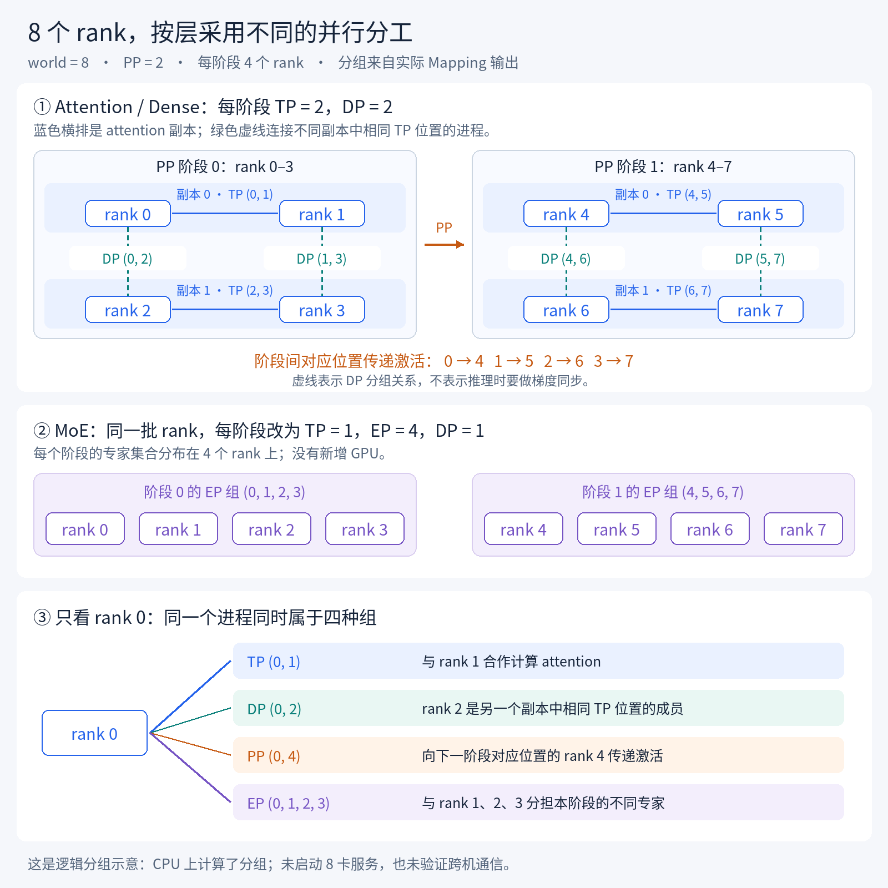

# 第五课 TP DP PP EP 分别把什么分给 GPU

先记住四个分工对象：**TP 分同一层的张量，DP 分不同请求，PP 分不同层，EP 分不同专家。** 它们描述逻辑分工，不直接规定单机或多机。

这份讲解对应本地 TokenSpeed 提交 `8289d0f4a9e122cec9ad7bc7bbb843fd9ade1613`。完整模型的 DP、PP、EP 服务尚未实测；后面的 8-rank 表来自真实 `Mapping` 类在 CPU 上计算的结果。[返回教程入口](README.md)。

## 1 先放在同一张表里

| 方式 | 多张卡分什么 | 计算时的关系 | 主要交换的数据 |
| --- | --- | --- | --- |
| TP 张量并行 | 同一层权重和特征的不同部分 | 合作处理同一批 token | 激活的部分和或分片，常见 AllReduce、AllGather、ReduceScatter |
| DP 数据并行 | 不同请求或 token 批次 | 经典完整副本方案中各副本独立推理 | 请求分发和调度信息；混合布局下还可能交换激活 |
| PP 流水线并行 | 不同层或连续层段 | 前一段完成后把结果交给后一段 | 阶段边界的 hidden states、必要的 residual 等 |
| EP 专家并行 | MoE 层的不同专家 | 按路由选择专家计算 | 发给专家的 token 激活，以及返回的专家结果 |

本教程讨论推理，所以没有反向传播。训练里的 DDP 常常需要同步梯度，不能把那种通信直接套到推理 DP 上。

## 2 TP 多张卡合作算同一层

[第四课](04_row_column_tp.md) 已实测一个 column → activation → row 的 TP=2 例子。每张卡只持有相应层的一部分权重，算完后按需要拼接或求和。

普通 TP 中，每张卡在处理同一批 token 的不同特征，因此会有层内协作。TP 可以降低单卡权重存储和部分计算量，但引入通信。卡越多不保证越快，特别是每次计算很小而通信启动开销明显时。

源码中 `mapping.attn.tp_group` 与 `mapping.dense.tp_group` 表示不同层类型的 TP 参与者，不应默认它们永远相同。

## 3 DP 多个副本处理不同请求

先看经典的完整副本方案：

```text
请求 A、B → 模型副本 0
请求 C、D → 模型副本 1
```

两个副本有相同的模型权重，但处理不同输入，也各自维护这些请求的缓存。它主要增加并发处理能力，不会自动把一个请求的前向计算拆开，也不解决单个完整副本装不进一张卡的问题。

可以把一个副本本身做成 TP=2，再复制两份：

```text
副本 0：GPU 0 + GPU 1，合作处理请求 A、B
副本 1：GPU 2 + GPU 3，合作处理请求 C、D

TP=2，DP=2，共 4 个进程
```

这里每个完整副本横跨两张卡；不能把“DP 副本”简单等同于“一张 GPU”。经典推理副本之间不需要像训练那样每步同步梯度，但仍可能有调度、统计等通信。

### TokenSpeed 的 attention DP 需要更细地理解

TokenSpeed 可以为 attention、dense 和 MoE 使用不同分组。因此 `mapping.attn.dp_size=2` 只描述 attention 的布局，不保证整套模型始终是两个完全独立的副本。

例如 attention 各自处理自己的 token，进入 dense 时可能先把 token 行 AllGather 到一个更宽的 TP 组；算完再 ReduceScatter 回各自所有者。这里交换的是激活，不是梯度。

源码入口：

- [mapping.py](https://github.com/lightseekorg/tokenspeed/blob/8289d0f4a9e122cec9ad7bc7bbb843fd9ade1613/python/tokenspeed/runtime/distributed/mapping.py) 的 `AttentionLayerMapping` 和 `DenseLayerMapping`：分别保存各自的 TP/DP 大小和组。
- [comm_manager.py](https://github.com/lightseekorg/tokenspeed/blob/8289d0f4a9e122cec9ad7bc7bbb843fd9ade1613/python/tokenspeed/runtime/distributed/comm_manager.py) 的 `pre_dense_comm`、`post_dense_comm`：负责布局之间的数据转换。

同一个请求的多轮对话应注意路由与缓存归属；TokenSpeed 官方说明中，attention-DP rank 拥有自己的 prefix cache，命中已有缓存需要请求落到相应 rank。[官方并行说明](https://lightseek.org/tokenspeed/serving/parallelism)

## 4 PP 不同设备负责不同层段

假设一个模型有 32 层，PP=2，最简单的分工是：

```text
阶段 0：第 0–15 层 → 发送中间激活 → 阶段 1：第 16–31 层
```

实际还要安排 embedding、最终归一化和输出头。不能只按层数推断两个阶段耗时一定相同。

对某一个请求，阶段 1 依赖阶段 0 的结果；不是两个阶段各算一半然后相加。让多个请求批次错开执行，才可能使不同阶段同时有事可做：

| 时间段示意 | 阶段 0 | 阶段 1 |
| --- | --- | --- |
| 1 | 批次 A | 等待 |
| 2 | 批次 B | 批次 A |
| 3 | 批次 C | 批次 B |
| 4 | 暂无新批次 | 批次 C |

这是帮助理解流水线的理想化示意，不是本次的调度测量。启动和排空时的空闲叫 pipeline bubble；阶段耗时不均也会造成等待。对自回归生成的同一个请求，下一个 token 通常仍需等待上一个 token 的最终结果。

### 对照 PP 源码

1. [pp_stage.py](https://github.com/lightseekorg/tokenspeed/blob/8289d0f4a9e122cec9ad7bc7bbb843fd9ade1613/python/tokenspeed/runtime/distributed/pp_stage.py) 的 `pp_layer_window` 计算本阶段负责的层范围。可以显式指定分区；默认尽量均分，余数分给前面的阶段。
2. [model_executor.py](https://github.com/lightseekorg/tokenspeed/blob/8289d0f4a9e122cec9ad7bc7bbb843fd9ade1613/python/tokenspeed/runtime/execution/model_executor.py) 的 `_pp_recv_stage_state` 接收前一阶段传来的张量，`_pp_send_stage_state` 向后一阶段发送。
3. [comm_ops.py](https://github.com/lightseekorg/tokenspeed/blob/8289d0f4a9e122cec9ad7bc7bbb843fd9ade1613/python/tokenspeed/runtime/distributed/comm_ops.py) 的 `pp_send`、`pp_recv` 调用通信后端的点对点发送和接收。

传输内容由模型的 `pp_stage_state_spec` 定义。普通解释可以先理解为 hidden states；实现上还可能带 residual 等边界状态，不是每次把所有权重或全部历史 KV 发到下一阶段。

PP 阶段内部仍可以使用 TP：两张卡合作计算前半层，另外两张卡合作计算后半层，就是 TP=2、PP=2 的一种布局。

## 5 EP 不同卡负责不同专家

MoE 层有多个专家子网络，router 根据 token 的特征选择其中的少数专家。这里的专家是模型里的计算模块。

以 4 个专家、EP=2 为例：

```text
GPU 0 放专家 E0、E1
GPU 1 放专家 E2、E3

token A 路由到 E0 和 E3
  → A 的激活发给相应专家所在的 GPU
  → E0、E3 分别计算
  → 结果返回并按路由权重合并
```

可以把这条路径概括为 `router → dispatch → expert compute → combine`。Top-k 路由可能把同一个 token 送给多个专家，因此不是把请求永久分配给某一张卡；下一层还可能选择不同专家。

EP 和 TP 的区别是：EP 按专家集合分工；TP 可以把某一个专家内部的矩阵再切开。后者在概念上可以组合，但具体框架和后端未必支持任意组合。

### 对照 EP 源码与当前限制

| 源码入口 | 看什么 |
| --- | --- |
| [moe/block.py](https://github.com/lightseekorg/tokenspeed/blob/8289d0f4a9e122cec9ad7bc7bbb843fd9ade1613/python/tokenspeed/runtime/layers/moe/block.py) 的 `MoEBlock.forward` | 先算 router logits，再 top-k，再调用 experts |
| [moe/expert.py](https://github.com/lightseekorg/tokenspeed/blob/8289d0f4a9e122cec9ad7bc7bbb843fd9ade1613/python/tokenspeed/runtime/layers/moe/expert.py) 的 `MoELayer` | 当前 rank 持有多少专家、使用什么后端执行 |
| [kernel 的 deep_ep.py](https://github.com/lightseekorg/tokenspeed/blob/8289d0f4a9e122cec9ad7bc7bbb843fd9ade1613/tokenspeed-kernel/python/tokenspeed_kernel/ops/moe/deep_ep.py) | DeepEP 路径中的 `dispatch_a/b` 与 `combine_a/b` |

当前 `MoELayer` 的普通构造路径要求专家数可以被 EP 数量整除，并设置：

```python
self.num_local_experts = num_experts // self.ep_size
```

同一构造器明确拒绝 `tp_size > 1` 且 `ep_size > 1`，报错为 `Mixed TP and EP is not supported yet.`。这里限制的是**该 MoE 层内部的 TP 与 EP 同时大于 1**，不表示模型不能在 attention 层用 TP、在 MoE 层用 EP。

也不能说 EP 一定直接调用 `torch.distributed.all_to_all_single`。当前源码区分 kernel 自己完成 all-to-all 分发的路径，以及复制 token、让本地专家计算后再合并的路径。`supports_all_to_all_ep` 和外层通信管理器共同决定数据流。DeepEP 是其中一种实现，本课只阅读它的代码，没有运行其 GPU 通信。

EP 的效果还受专家负载影响：若大量 token 都路由到少数专家，其他设备可能在等待。专家存储均分，不代表每一步计算量也均分。

## 6 用真实 Mapping 类看 8 个 rank 怎么分组

代码：[05_mapping.py](05_mapping.py)。它只在 CPU 上创建分组对象，不初始化分布式通信，也没有启动 8 张 GPU。

```bash
cd /home/hadoop-scale-llm/dasc
source tokenspeed_learning/env.sh
python tokenspeed_learning/05_mapping.py
```

配置含义：总共 8 个 rank，PP=2，因此每个阶段有 4 个 rank。每个阶段内：

- attention：TP=2、DP=2。
- dense：TP=2、DP=2。
- MoE：TP=1、EP=4、DP=1。

### 先用图理解这些分组



[查看可放大的 SVG 矢量图](assets/05_mapping_groups.svg)。图片根据下方日志绘制；[绘图脚本](draw_mapping.py) 可以重新生成 PNG 和 SVG。

按颜色依次看：

1. **蓝色横排看 TP。** 阶段 0 中，`(0,1)` 合作计算一批请求的 attention，`(2,3)` 合作计算另一批请求；每一排是该阶段的一个 attention 副本。
2. **绿色纵线看 DP。** 两个副本中，rank 0 与 rank 2 负责相同的 TP 位置，所以组成 DP 组 `(0,2)`；另一位置对应 `(1,3)`。DP 组连接副本的对应成员，它本身不是一个完整副本。
3. **橙色方向看 PP。** 下一阶段延续对应位置：`0→4`、`1→5`、`2→6`、`3→7`。例如前一阶段由 `(0,1)` 合作处理的请求，在后一阶段由 `(4,5)` 继续处理。
4. **紫色框看 EP。** 在 MoE 层，同一阶段的四个 rank 分担不同专家。因此阶段 0 的 EP 组是 `(0,1,2,3)`，阶段 1 是 `(4,5,6,7)`。

上下两部分是**同一套进程在不同层类型中的分组视图**；重复出现的 rank 0 仍然是同一个进程。实际前向按模型的层顺序执行，并不是先执行图里所有 attention，再执行所有 MoE。

图中没有指定这些 rank 属于哪台物理机器；PP 阶段也不等同于机器编号。

### 对照实际分组输出

2026 年 11 月 23 日实际执行输出，见 [原始日志](logs/05_mapping.log)：

```text
CPU-only layout calculation; no GPU workers or network collectives started
world=8; PP=2; per stage: attention TP=2 DP=2; dense TP=2 DP=2; MoE TP=1 EP=4 DP=1
rank=0 pp_rank=0 attn_tp=(0, 1) attn_dp=(0, 2) pp=(0, 4) moe_ep=(0, 1, 2, 3)
rank=1 pp_rank=0 attn_tp=(0, 1) attn_dp=(1, 3) pp=(1, 5) moe_ep=(0, 1, 2, 3)
rank=2 pp_rank=0 attn_tp=(2, 3) attn_dp=(0, 2) pp=(2, 6) moe_ep=(0, 1, 2, 3)
rank=3 pp_rank=0 attn_tp=(2, 3) attn_dp=(1, 3) pp=(3, 7) moe_ep=(0, 1, 2, 3)
rank=4 pp_rank=1 attn_tp=(4, 5) attn_dp=(4, 6) pp=(0, 4) moe_ep=(4, 5, 6, 7)
rank=5 pp_rank=1 attn_tp=(4, 5) attn_dp=(5, 7) pp=(1, 5) moe_ep=(4, 5, 6, 7)
rank=6 pp_rank=1 attn_tp=(6, 7) attn_dp=(4, 6) pp=(2, 6) moe_ep=(4, 5, 6, 7)
rank=7 pp_rank=1 attn_tp=(6, 7) attn_dp=(5, 7) pp=(3, 7) moe_ep=(4, 5, 6, 7)
```

看 rank 0 这一行就可以理解四种组：

| 组 | 成员 | 对 rank 0 的含义 |
| --- | --- | --- |
| attention TP | `(0, 1)` | 与 rank 1 合作计算同一批 token 的 attention |
| attention DP | `(0, 2)` | rank 2 是另一个 attention 副本中相同 TP 位置的进程 |
| PP | `(0, 4)` | rank 4 是下一阶段中相同阶段内位置的进程 |
| MoE EP | `(0, 1, 2, 3)` | 该阶段的专家集合分布在这 4 个 rank 上 |

**DP group `(0, 2)` 不是说 0 和 2 合起来构成一个完整 attention 副本。** 本阶段的两个 TP 副本是 `(0, 1)` 和 `(2, 3)`；DP group 则连接两个副本中相同 TP 位置的成员。一个 rank 可以同时属于多种组。

### 分组公式也在源码里

[mapping.py](https://github.com/lightseekorg/tokenspeed/blob/8289d0f4a9e122cec9ad7bc7bbb843fd9ade1613/python/tokenspeed/runtime/distributed/mapping.py) 的 `_make_parallelism_rank` 使用：

```python
(rank // stride) % size
```

本例同一阶段内的 TP 编号变化最快，所以 TP 组是相邻的 `(0, 1)`；DP 的步长是 `tp_size=2`，所以形成 `(0, 2)`。PP 的步长是 `stage_world_size=4`，所以形成 `(0, 4)`。

`Mapping.__init__` 首先用 `world_size // pp_size` 得到每阶段进程数，再为 attention、dense 和 MoE 分别建立映射。这个例子的数量关系是：

```text
全局进程数 = PP × 每阶段进程数 = 2 × 4 = 8
attention：每阶段进程数 = TP × DP = 2 × 2 = 4
MoE：每阶段进程数 = MoE TP × EP × MoE DP = 1 × 4 × 1 = 4
```

不能把这里的 attention TP、attention DP、MoE EP 和 PP 不加区分地全乘起来。它们有的描述同一批进程在不同层里的不同组织方式。

## 7 单机还是多机由部署位置决定

TP、DP、PP、EP 都是逻辑分工。一个 TP 组可以在同一节点内，也可以跨节点；PP 不必然是多机，EP 也不必然是单机。

常见安排会尽量让频繁的 TP 通信使用较快的连接，但具体放置还取决于模型大小、网卡、节点拓扑和负载。不能仅凭并行缩写判断性能，或认为跨机一定只传一次数据。

如果只是判断主要作用，可以先这样理解：TP/PP 帮助拆分模型，DP 帮助同时处理更多请求，EP 帮助分布 MoE 专家；实际吞吐和延迟还取决于通信、负载平衡和调度。

## 8 读后自测

| 场景 | 主要属于哪一种 |
| --- | --- |
| 两张卡算同一个线性层的不同输出特征 | Column parallel，属于 TP |
| 两张卡算同一个线性层的不同输入特征贡献，之后求和 | Row parallel，属于 TP |
| 两份完整模型副本分别回答不同用户 | 经典推理 DP |
| 第一张卡跑前 16 层，第二张卡跑后 16 层 | PP |
| 第一张卡放 E0/E1，第二张卡放 E2/E3，按 router 选择专家 | EP |

下一次读任意一段通信代码，先标出它处理的是哪些 token、哪些特征、哪一层、哪些专家，再看它所属的 group，就能把具体调用与这四种分工对应起来。

继续阅读：[第七课 MoE 并行与通信](07_moe_parallel.md)，通过四卡配图、张量维度和 CPU 通信量计算，理解路由专家、共享专家与 SP 的衔接。
