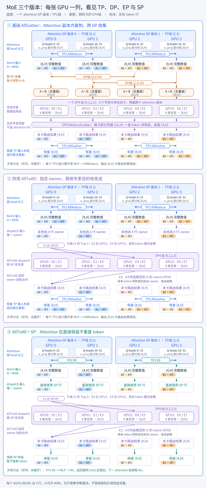
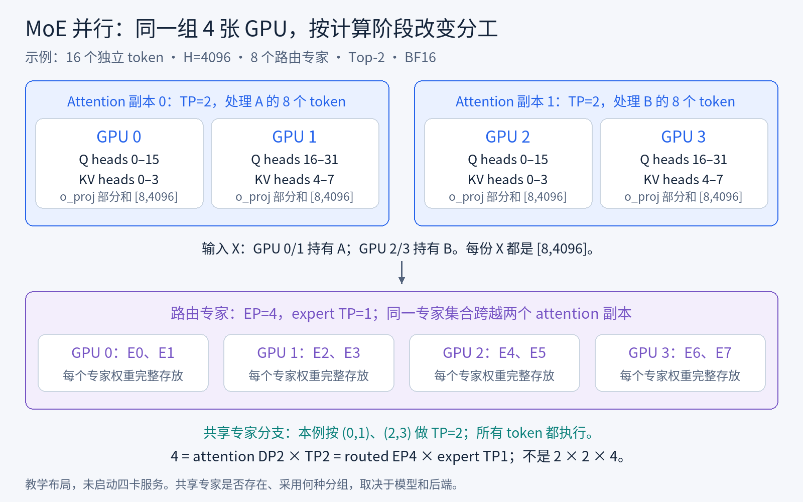
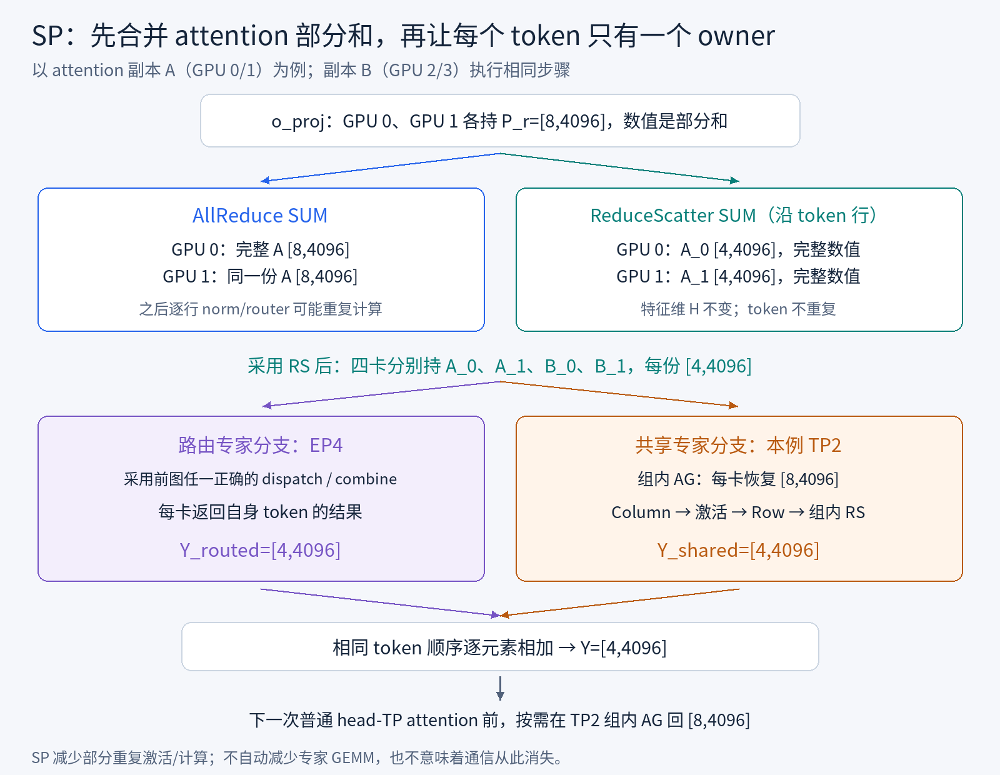
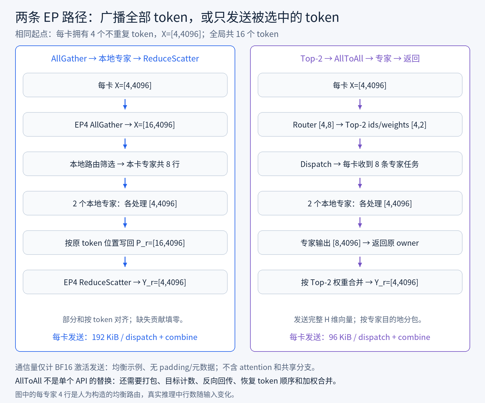

# 第七课 MoE 并行与通信

**按三个版本依次理解：先用 AllGather 分发全部 token，再改为 AllToAll 按专家目的地发送，最后用 SP 减少 TP 组内的重复 token 激活与计算。** AllToAll 改的是专家之间怎样收发，SP 改的是层间怎样保存和处理 token；这是便于学习的顺序，两种选择可以独立组合。

[返回教程入口](README.md) · 前置知识：[线性层的 Row 与 Column 并行](04_row_column_tp.md)、[TP DP PP EP 分组](05_tp_dp_pp_ep.md)。源码对应 TokenSpeed 固定提交 `8289d0f4a9e122cec9ad7bc7bbb843fd9ade1613`。

下面三个版本使用同样的四张卡、同一模型与同一批输入，仅改变通信和激活布局。这是教学推导与 CPU 计算，没有启动四卡 MoE 服务或测量速度。



[总览图 SVG](assets/moe_three_versions.svg)。三个版本从上到下排列；**每个版本内部，四列始终对应 GPU 0、1、2、3**。图中 $H=4096$，AG 表示 AllGather，RS 表示 ReduceScatter。

读图时先看哪些 GPU 在一起，再看 token 如何移动：

- **TP 与 DP**：蓝框分别圈住 GPU 0/1、GPU 2/3。每个框是一个 attention DP 副本，框内两卡组成 TP2 组，分别计算不同 head；第一版橙色横线连接跨副本的 DP 组 $(0,2)$、$(1,3)$。
- **EP**：紫框横跨四张 GPU，各卡存放不同专家。第二、三版用真实教学路由中的 token `t1` 举例：GPU 0 将它发给 GPU 1 的 E3 和 GPU 2 的 E4，专家结果再返回 GPU 0。其余 token 的连线省略，避免箭头遮挡。
- **SP**：每个色块 A0、A1、B0、B1 代表 4 行 token。前两版的 Norm 输入中，GPU 0/1 都持 A0+A1，GPU 2/3 都持 B0+B1；第三版从 attention 输出后就分别持 A0、A1、B0、B1，每卡只有 $[4,H]$，特征维度 $H$ 不变。

单独放大：[第一版 AllGather](assets/moe_version_1_lanes.png) · [第二版 AllToAll](assets/moe_version_2_lanes.png) · [第三版 AllToAll 加 SP](assets/moe_version_3_lanes.png)。对应的 [第一版 SVG](assets/moe_version_1_lanes.svg)、[第二版 SVG](assets/moe_version_2_lanes.svg)、[第三版 SVG](assets/moe_version_3_lanes.svg) 可无损缩放。

共享专家与路由专家并列，总图只在底部标明其分组及输出布局；具体分支计算见第 5 节。图中虚线用于对齐 GPU 所在列，不表示通信链路；实际通信由带方向的实线标注。

| 版本 | Attention 输出处理 | 专家分发与返回 | FFN 结束后的每卡布局 |
| --- | --- | --- | --- |
| 1 基础 AllGather | TP2 AllReduce | DP2 AllGather → 专家 → EP4 ReduceScatter → TP2 AllGather | $[8,H]$，同一副本内复制 |
| 2 改用 AllToAll | 仍为 TP2 AllReduce | 本地指定唯一 owner → AllToAll → 专家 → 返回 → TP2 AllGather | 仍为 $[8,H]$，同一副本内复制 |
| 3 再加入 SP | TP2 ReduceScatter | owner 直接路由 → AllToAll → 专家 → 返回，保持分片 | $[4,H]$，组内不重复；下一次 attention 前按需恢复 |

## 1 固定模型分组和张量尺寸

对于含共享专家的模型，FFN 通常包含两个分支：

$$
y_t=f_{\mathrm{shared}}(x_t)+\sum_{e\in\operatorname{TopK}(t)}p_{t,e}f_e(x_t)
$$

每个 token 都经过共享专家，只经过 router 选择的少数路由专家。两路一般是从同一个 FFN 输入分出的分支，输出相加，不是先经过路由专家再经过共享专家。本式省略模型可能采用的共享门控与外部残差。

“共享”指所有 token 都能使用这个专家，不代表权重必须在每张 GPU 完整复制。共享专家可以 TP，也可以复制后分别处理不同 token；具体取决于模型和实现。并非所有 MoE 模型都有共享专家。

### 同四张 GPU 的不同分工



[下载 SVG](assets/moe_4gpu_groups.svg)。图中设 Q head 数为 32、KV head 数为 8、head 维度为 128。

| 计算部分 | 本例分组 | 每卡的工作 |
| --- | --- | --- |
| Attention | TP 组 $(0,1)$、$(2,3)$；两个 DP 副本 | 同一副本内按 head 分片，两个副本处理不同请求 |
| 路由专家 | EP 组 $(0,1,2,3)$；expert TP=1、expert DP=1 | 每卡完整存放两个不同专家 |
| 共享专家 | 本例采用 TP 组 $(0,1)$、$(2,3)$ | 两卡合作计算一个共享 FFN；权重在两个副本间复制 |

这是**同四张卡在不同计算部分的不同分组**：

$$
4=\mathrm{DP}_{\mathrm{attn}}\mathrm{TP}_{\mathrm{attn}}
=\mathrm{DP}_{\mathrm{expert}}\mathrm{EP}\mathrm{TP}_{\mathrm{expert}}
=2\times2=1\times4\times1
$$

不能把 attention 的 TP=2 再乘进 EP=4，声称每个路由专家还使用 TP=2。本地 TokenSpeed 的普通 `MoELayer` 恰好不支持同一专家层同时 TP>1、EP>1，但不妨碍这里 attention TP2、路由专家 EP4 的组合。

### 所有版本采用相同尺寸

| 参数 | 本例取值 |
| --- | ---: |
| 全局不同 token 行数 $N$ | 16 |
| 每个 attention DP 副本的 token 行数 $T$ | 8 |
| Hidden size $H$ | 4096 |
| 路由专家数 $E$、每卡专家数 | 8、2 |
| 每个 token 选择的专家数 $k$ | 2 |
| 每个路由专家的中间维度 $I$ | 2048 |
| 共享专家的中间维度 $I_s$ | 4096 |
| 用于通信量估算的激活类型 | BF16，每元素 2 bytes |

Decode 时可理解为两个副本各处理 8 个活跃请求，每个请求贡献当前 token 的一行。**这些请求的 attention 仍使用各自的 KV cache，不会相互关注。** FFN 按行独立处理，所以可以把它们组成一个矩阵用于路由与专家计算。

每个 attention TP rank 的输入都是 $[8,4096]$。Q 投影输出 $[8,16,128]$，K/V 各为 $[8,4,128]$；本地 attention 输出展平为 $[8,2048]$，经 row-parallel `o_proj` 产生 $[8,4096]$ 的部分和。


## 2 第一版 普通 AllGather 分发

先不引入层间 SP。Attention 的两个副本分别处理 A、B，各有 8 行。注意这里讨论的是 **attention 后的 o_proj 输出归约**，不是 softmax 的 LSE 修正。

### 第一步 Attention 在各 TP2 组内 AllReduce

GPU 0/1 分别计算 attention 不同 head 的输出投影贡献，均为部分和 $[8,H]$。组内求和后，两卡都得到完整的 A：

$$
X_A=P_0+P_1\in\mathbb R^{8\times4096}
$$

GPU 2/3 同理，都得到 B。因此此时是：

| GPU | 完整激活 | 形状 |
| --- | --- | --- |
| 0 | A | $[8,4096]$ |
| 1 | A 的副本 | $[8,4096]$ |
| 2 | B | $[8,4096]$ |
| 3 | B 的副本 | $[8,4096]$ |

后续 Norm 在这份复制布局上执行，每个 token 的完整 hidden 特征都在本地。

### 第二步 跨 DP AllGather

分别在组 $(0,2)$、$(1,3)$ 中 AllGather，让每卡都看到 A 与 B：

$$
[8,H]\xrightarrow{\mathrm{AG\ over\ DP2}}[16,H]
$$

**这里不能直接把四卡复制输入一并 AllGather。** 否则会收集成 $[A;A;B;B]$，共 32 行，重复处理了数据。指定通信组是正确性的一部分。

### 第三步 Router 与本地专家计算

每卡能看到所有 16 个 token，但只执行落到本卡专家的任务。本例 8 个专家、Top-2，全局专家任务数为：

$$
Nk=16\times2=32
$$

采用后文 CPU 程序构造的均衡路由，每卡两个专家合计处理 8 条任务，每专家 4 条。AllGather 不代表所有专家都对所有 token 做 MLP。

### 第四步 合并专家贡献并恢复原布局

每卡把加权专家输出放回全局 token 顺序，形成 $P_r^{\mathrm{expert}}\in\mathbb R^{16\times H}$；没有本地专家贡献的行填零。EP4 ReduceScatter 同时求和及分行：

$$
[16,H]\xrightarrow{\mathrm{RS\ over\ EP4}}[4,H]
$$

GPU 0/1 分别拿到 A 的前 4 行、后 4 行；GPU 2/3 分别拿到 B 的前后两半。为了回到本版本复制的层间布局，再在各 TP2 组 AllGather：

$$
[4,H]\xrightarrow{\mathrm{AG\ over\ TP2}}[8,H]
$$

到这里，路由分支的完整 A 又出现在 GPU 0/1，完整 B 又出现在 GPU 2/3。

共享专家分支从同一个 FFN 输入出发，本例采用 TP2 的 Column→激活→Row→AllReduce，输出也是复制的 $[8,H]$。与路由分支按 token 对齐相加后，再进入后续层。

**第一版已经包含 ReduceScatter：它位于路由专家的输出侧，用来合并专家贡献。还没有把 attention 的 AllReduce 改为 ReduceScatter。**


## 3 第二版 只把专家分发改成 AllToAll

保留第一版的 attention AllReduce、复制布局上的 Norm，以及共享专家的 TP2 路径。现在只改变路由专家分支：不用把全量 token 广播到每张卡，而是先决定专家，再把激活发送到相应 GPU。

### 第一步 给 dispatch 指定唯一 token owner

因为 GPU 0/1 都有 A，不能让两卡把同一个 token 的相同 Top-2 任务各发送一遍。本例在本地选择：

| GPU | 用于专家 dispatch 的 token | 形状 |
| --- | --- | --- |
| 0 | A 的前 4 行 | $[4,H]$ |
| 1 | A 的后 4 行 | $[4,H]$ |
| 2 | B 的前 4 行 | $[4,H]$ |
| 3 | B 的后 4 行 | $[4,H]$ |

这是从已经复制的完整激活中选取 owner 行，切片本身不需要通信。其他 owner 分配也可行，但每个 token 的任务只能被正确派发一次。

**这里已经在专家收发边界划分了 token 所有权，但 attention 之后的 Norm 等区域仍使用复制的 $[8,H]$。** 第三版的变化，是把不重复的 token 布局向前、向后扩展到更多算子；不能仅凭某一时刻每卡有 4 行就判断整个网络是否采用了 SP。

### 第二步 先 router 再 AllToAll

本地 owner 的 router 权重为 $[4096,8]$：

$$
[4,4096]\times[4096,8]=[4,8]
$$

Top-2 产生专家 ID 与权重，各为 $[4,2]$，共 8 条任务。每条任务携带完整 $H$ 维激活及必要元数据，根据专家所在 GPU 打包发送。本卡专家的任务可留在本地。

AllToAll/AllToAllv 或专用 EP kernel 按目的地交换任务。本例每卡处理 8 条专家任务，与第一版完全相同；真实路由不均衡时，每卡任务张量应写成 $[n_r,H]$。

### 第三步 返回结果并恢复复制布局

专家输出通过返回通信交给原 token owner，再按路由权重合并：

$$
y_t^{\mathrm{routed}}=\sum_{e\in\operatorname{TopK}(t)}p_{t,e}f_e(x_t)
$$

每个 owner 得到自己 4 个 token 的完整 $[4,H]$。这里返回的是按需传输的专家结果，不需要再对所有 token 做第一版的 EP4 dense ReduceScatter。

随后仍然在 TP2 组内 AllGather 回 $[8,H]$，再与共享分支的复制结果相加。**第二版的层间输入、输出布局与第一版相同，主要改变专家之间的 dispatch/combine。**

AllToAll 不是 AllGather 的单个 API 替换；它要求配套的路由、打包、目标计数、结果回传、顺序恢复和加权合并。第二次通信通常是反向 dispatch 的 AllToAll 或专用 combine。


[Megatron token dispatcher 文档](https://docs.nvidia.com/megatron-core/developer-guide/latest/apidocs/core/core.transformer.moe.token_dispatcher.html) 分别描述 AllGather 和 AllToAll dispatcher；[DeepEP](https://github.com/deepseek-ai/DeepEP) 提供专用的专家 dispatch/combine 通信实现。

## 4 第三版 在 AllToAll 的基础上加入 SP

第二版虽然最终只派发每卡 4 行，但之前已经把完整 A/B 各复制到 TP 两卡，并在复制布局上执行 Norm。现在把 attention 输出归约改成沿 token 行的 ReduceScatter，直接产生唯一 owner 的输入：

$$
\begin{aligned}
X_A&=P_0+P_1,\\
X_0&=X_A[0:4,:],\qquad X_1=X_A[4:8,:].
\end{aligned}
$$

GPU 0/1 各得到 $[4,4096]$，而不是各得到 $[8,4096]$。这四行的特征维度和数值都完整；切的是 token 行，不是把 hidden size 从 4096 切成 2048。

接下来的路径为：

```text
Attention 部分和 [8,H]
  → TP2 ReduceScatter
  → 本卡完整 token [4,H]
  → 本卡 Norm / Router
  → AllToAll dispatch → 专家计算 → 返回并合并
  → 本卡完整结果 [4,H]
  → 保持分片，与相同 token 的共享分支结果相加
  → 后续逐行操作仍可在 [4,H] 上执行
  → 下一次普通 head-TP attention 前，按需 AllGather 回 [8,H]
```

和第二版相比，专家任务数没有减少。减少的是一部分重复激活、Norm、残差等逐行操作；Router 是否减少重复，还取决于它之前是否已经在唯一 owner 上执行。

### 两处 ReduceScatter 的作用不同

| 位置 | 通信组 | 输入是什么 | 输出是什么 |
| --- | --- | --- | --- |
| 第一版路由专家输出侧 | EP4 | 不同专家对同一全局 token 表的部分贡献 $[16,H]$ | 合并后的 owner 行 $[4,H]$ |
| 第三版 attention 输出侧 | TP2 | 不同 head 的输出投影部分和 $[8,H]$ | 合并后的 owner 行 $[4,H]$ |

共享分支也可以在它自己的 row-parallel 尾部使用 TP2 ReduceScatter，见下一节。相同 collective 名字可能出现在不同位置，必须同时标注通信组与张量含义。

### SP 不是 AllToAll 的前提

从优化目标看，它们是两个独立选择：

- AllGather→AllToAll：改变专家激活的发送范围和结果返回方式。
- 复制布局→SP：在相邻算子之间保持不重复的 token 行。

所以也可以使用 **SP + AllGather/ReduceScatter**：attention 先输出每卡不重复的 $[4,H]$，再在 EP4 AllGather 成 $[16,H]$，最后 EP4 ReduceScatter 回 $[4,H]$。第 7 节的旧对比图正是在这种统一 owner 输入下比较两种 dispatcher，不应把它误读成第一版的完整数据流。

第三版暂缓部分 AllGather，但没有让后续通信消失。在相容布局下，AllReduce 可以理解成 ReduceScatter 后接 AllGather；SP 让中间适合的算子在分片布局上执行。


## 5 共享专家如何配合三个版本

第一、二版共享专家采用复制输入 $[8,H]$，通过 TP2 的 Column→激活→Row→AllReduce 得到复制输出 $[8,H]$。第三版则需要下图中的布局转换，让共享结果与路由结果对应到相同的 owner 行。



[下载 SVG](assets/moe_sp_shared.svg)。第三版采用本例共享专家 TP2 时，每卡只有 4 行，不能直接让 TP 两卡对不同 token 做 row 输出求和。必须先让两卡计算相同的 token 行：

| 共享分支步骤 | 每卡形状 |
| --- | --- |
| SP 输入 | $[4,4096]$ |
| TP2 内 AllGather token 行 | $[8,4096]$ |
| Gate、Up 分别 column parallel，$I_s/2=2048$ | 各为 $[8,2048]$ |
| SiLU(gate) × up | $[8,2048]$ |
| Down row parallel，本地权重 $[2048,4096]$ | 部分和 $[8,4096]$ |
| TP2 内 ReduceScatter | 完整数值的本地行 $[4,4096]$ |

路由分支也返回本地 $[4,4096]$，两者按同一 token 顺序相加。下一次普通 head-TP attention 需要两卡持有相同 token 行时，再在各 TP2 组 AllGather 回 $[8,4096]$。两个 FFN 分支可能重叠执行，但不代表必然完全隐藏通信。

SP 能减少 Norm、残差等逐行操作的重复存储与计算。Router 若在不重复的 token owner 上执行，也能避免重复；如果先 AllGather 所有 token 再在每卡重复 router，router 的重复计算仍然存在。SP 不自动减少选中专家的 GEMM，也不自动保证端到端更快。

在相容的布局下，AllReduce 可理解为 ReduceScatter 后再 AllGather。SP 把中间某段计算放在这两步之间，让它在不重复的 token 行上执行，而不是简单地把后半段通信永久删掉。

## 6 专家内部的矩阵乘法

每个专家本身仍是一个 MLP。采用 SwiGLU，且不含 bias：

$$
f_e(X_e)=\left[\operatorname{SiLU}(X_eW_{g,e})\odot(X_eW_{u,e})\right]W_{d,e}
$$

本例某专家接收 4 条任务：

| 步骤 | 数学权重 | 输出 |
| --- | --- | --- |
| Gate 投影 | $[4096,2048]$ | $[4,2048]$ |
| Up 投影 | $[4096,2048]$ | $[4,2048]$ |
| SiLU 与逐元素乘法 | 无 | $[4,2048]$ |
| Down 投影 | $[2048,4096]$ | $[4,4096]$ |

专家没有 TP，本卡算完整的三组权重。各专家的 token 数可以不同，grouped GEMM 把这些不同大小的专家计算组织起来，并不要求所有专家永远是 4 行。

一个专家的权重元素数为 $3HI$，若全部为 BF16，则：

$$
3\times4096\times2048\times2\ \mathrm{bytes}=48\ \mathrm{MiB}
$$

每卡两个路由专家占 96 MiB，仅为该教学 FFN 的权重，不包含 attention、共享专家、router 或临时 buffer。EP 减少每卡持有的专家数量；Top-k 减少每个 token 实际调用的专家数量。两者不是同一件事。

## 7 补充 固定 owner 输入时的通信量比较

这是补充比较：**固定每卡已经拥有 4 个不重复 token**，只比较专家 dispatcher 的通信量；不比较上面三个完整版本的总通信量。第一版进入 AllGather 前仍是复制的每卡 8 行，通信组也不同，因此不能把此表直接贴到三个版本上。



[对比图 SVG](assets/moe_dispatch_shapes.svg)。左侧的 AllGather 路径可与 SP 组合；右侧是第二、三版指定唯一 owner 后共同使用的 AllToAll 路径。

一行 BF16 激活的大小为：

$$
B_{\mathrm{row}}=4096\times2=8192\ \mathrm{bytes}=8\ \mathrm{KiB}
$$

全局 16 行共 $B=128$ KiB。这里只比较 **EP 路由分支每卡发送的激活字节数**，不把接收字节再加一次；不计 attention、共享专家、metadata、padding、协议开销、跨节点多跳以及量化。AllGather/ReduceScatter 按均衡 ring 等价量计算。

对 $P=4$：

$$
V_{\mathrm{AG}}=V_{\mathrm{RS}}=\frac{P-1}{P}B=96\ \mathrm{KiB}
$$

本例人为构造每个 source 向每个 destination 各分配两条任务，因此每卡 8 条任务里，有 2 条留在本卡，6 条需要发到其他 GPU。每条发送 8 KiB：

$$
V_{\mathrm{dispatch}}=6\times8=48\ \mathrm{KiB}
$$

返回阶段同样发送 48 KiB。两条路径都执行同样的 32 条专家任务，减少的是激活传播范围，不是少算了专家。

| EP 路径 | Dispatch 发送 | Combine 发送 | 每卡合计 |
| --- | ---: | ---: | ---: |
| AllGather + ReduceScatter | 96 KiB | 96 KiB | 192 KiB |
| 路由 AllToAll + 返回 | 48 KiB | 48 KiB | 96 KiB |

这个例子不能推广为“AllToAll 总是快两倍”。真实结果取决于 Top-k、EP 大小、token 数、目标 GPU 去重、专家负载、启动和打包开销、NVLink/网卡拓扑以及通信计算重叠。大通信量时定向发送更可能有利，小 decode batch 时启动和路由开销可能主导；Top-k 很大或专家分布集中时结论也可能变化。

## 8 本地源码与计算记录

| 位置 | 对应本节内容 |
| --- | --- |
| `moe/block.py` 的 `MoEBlock.forward` | Router→Top-k→专家，另算共享分支并相加 |
| `moe/expert.py` 的 `MoELayer` | 本地专家数、expert TP/EP 约束、后端的通信能力 |
| `distributed/comm_manager.py` 的 `post_attn_comm` | attention 部分和做 AllReduce 或 token ReduceScatter |
| 同文件的 `pre_moe_comm`、`post_moe_comm` | 普通复制路径的 token AllGather 与专家部分和归约；特殊 combine 顺序有不同处理 |
| 同文件的 `pre_dense_comm`、`post_dense_comm` | 共享/Dense 路径需要的布局转换 |
| `models/deepseek_v41_moe.py` 的 `_forward_shared_experts` | 一个显式通过 Dense 通信接口衔接共享分支的模型例子 |

共享专家分组不是仅由 `mapping.dense` 这个名字决定；其他模型或融合后端可以选择不同布局。上图用于解释一套自洽的数据流，不能据此假定每个模型的实际 kernel 调用完全相同。

运行维度与路由计算：

```bash
cd /home/hadoop-scale-llm/dasc
python3 tokenspeed_learning/moe_layout_dimensions.py
python3 tokenspeed_learning/draw_moe_parallel.py
```

程序仅在 CPU 上构造路由计数、计算字节数，并用标量专家输出示例检查广播归约与定向返回的加权和一致；没有运行真实专家 GEMM 或网络 collective。结果保存在[日志](logs/moe_dimensions.log)，逐 token 的专家选择及计算口径见 [JSON](assets/moe_dimensions.json)。输出如下：

```text
CPU arithmetic only; no GPU or network execution
world=4; attention TP=2 DP=2; routed experts TP=1 EP=4 DP=1
tokens=16; per-DP=8; unique rows/rank=4; H=4096; E=8; topk=2; BF16
dispatch count matrix (source rows, destination columns):
[2, 2, 2, 2]
[2, 2, 2, 2]
[2, 2, 2, 2]
[2, 2, 2, 2]
rows per expert: [4, 4, 4, 4, 4, 4, 4, 4]
allgather: 96 KiB sent per rank
reduce_scatter: 96 KiB sent per rank
allgather_plus_reduce_scatter: 192 KiB sent per rank
alltoall_dispatch: 48 KiB sent per rank
alltoall_return: 48 KiB sent per rank
alltoall_dispatch_plus_return: 96 KiB sent per rank
PASS: broadcast/local-filter/reduce and routed-return have identical scalar sums
Not a performance measurement; excludes shared branch and other communication
```

下一章：[Attention 并行优化](08_attention_parallel_optimization.md)，继续看 MoE 后的 token 分片怎样进入 DeepSeek-V4.1 的 Attention，以及通信为何可以移动到小投影之后。
