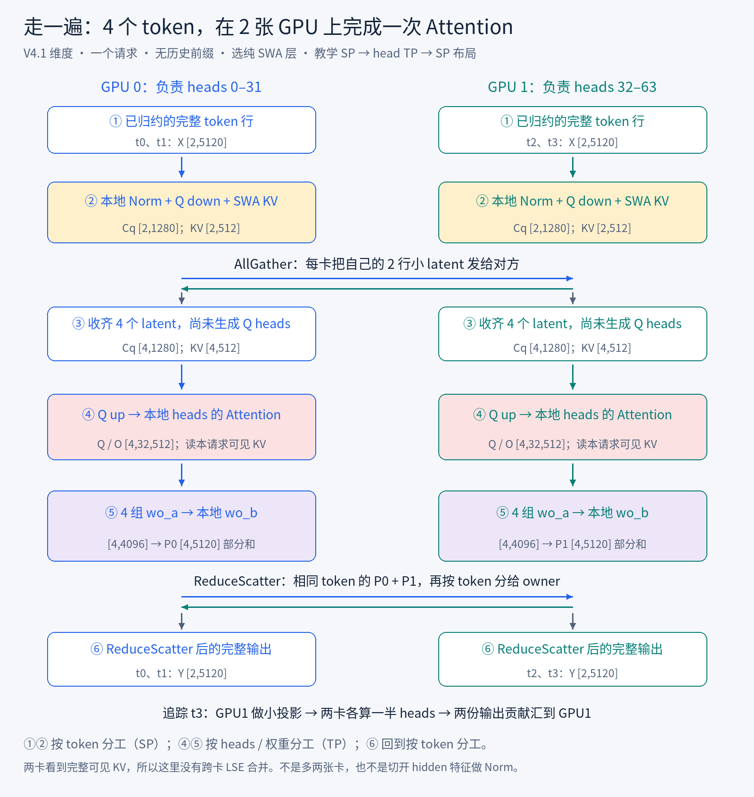
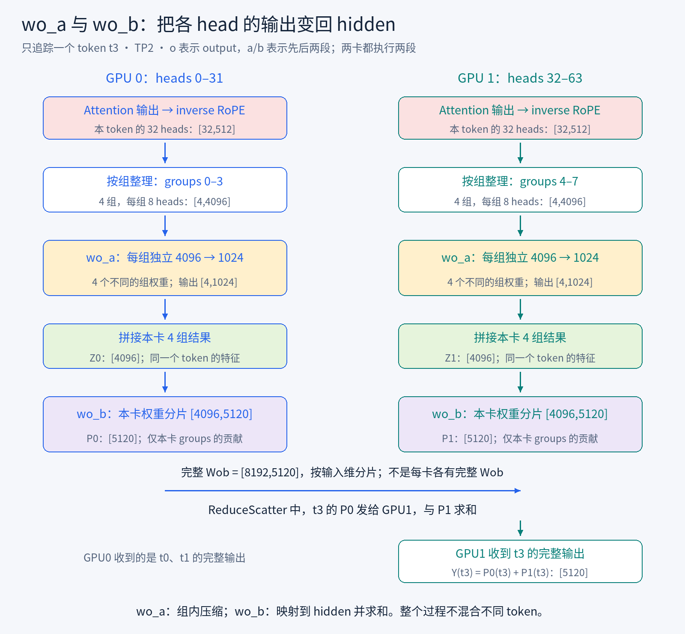
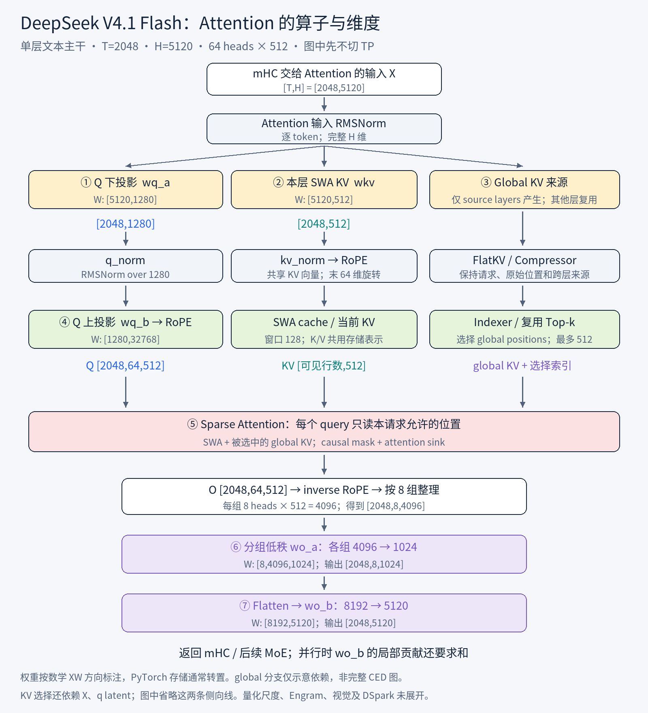
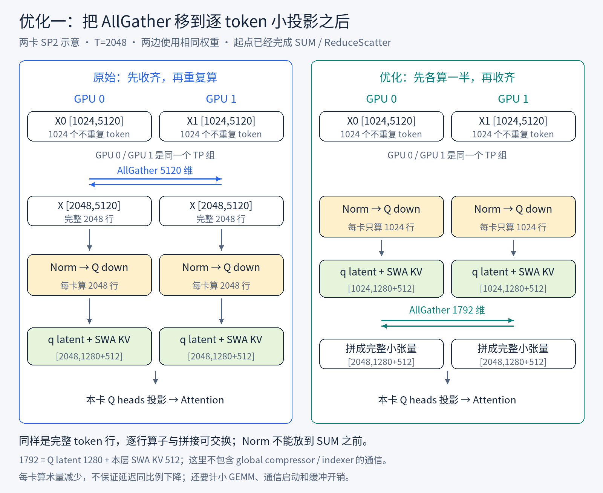
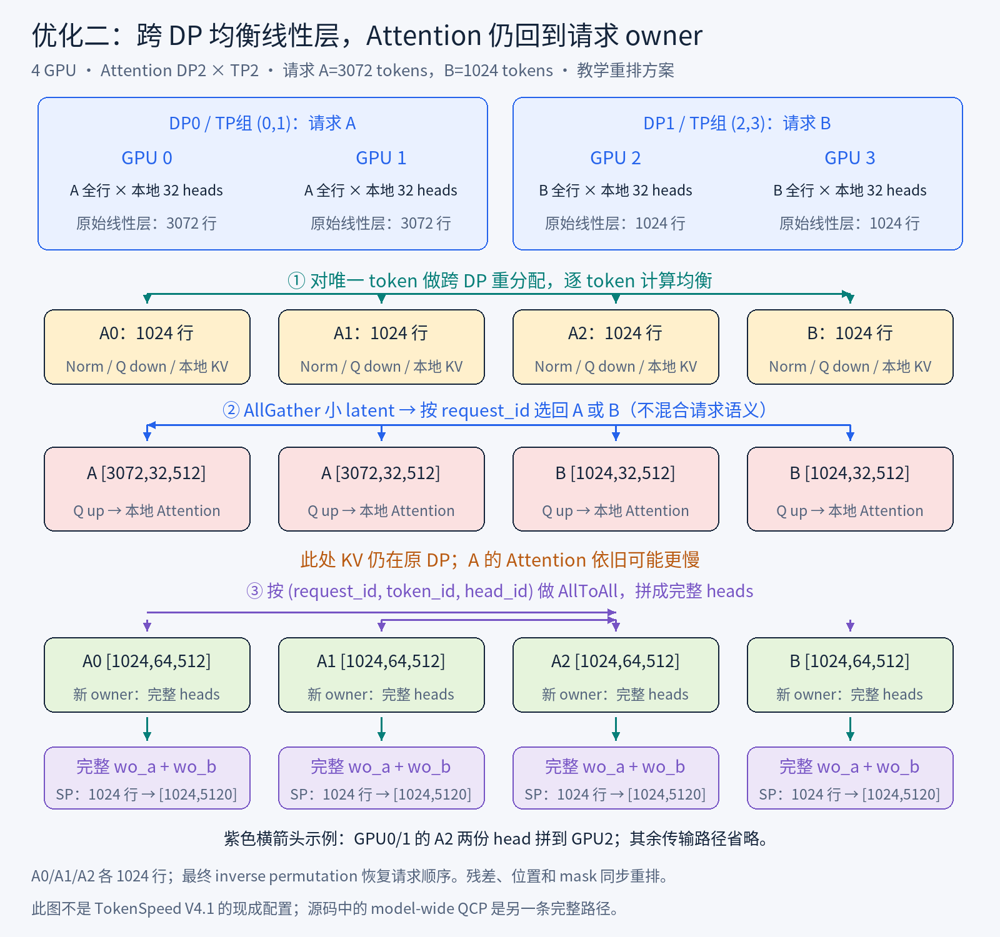
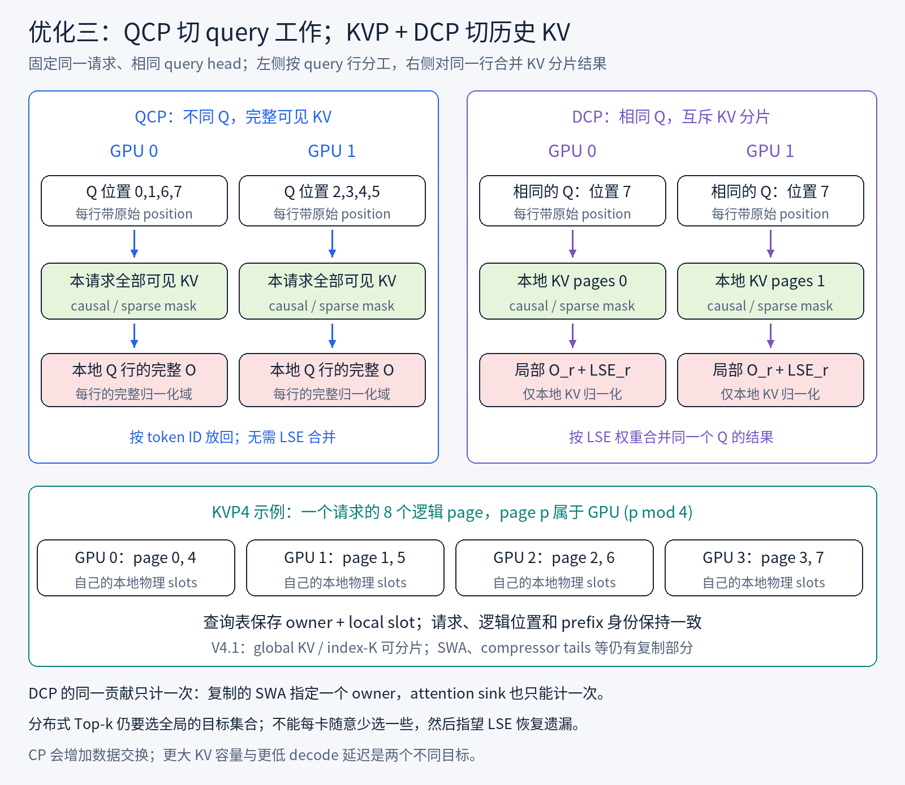

# 第八章 Attention 并行优化

第七章从 AllGather、AllToAll 讲到 MoE 的 SP；这一章继续追踪 **MoE 输出如何进入 Attention、哪些通信可以移动、长短请求怎样重新分工、KV 分片后怎样正确恢复答案**。每次改变布局，都同时检查三件事：每卡有哪些 token、每个 token 有多少特征、权重放在哪里。

按“最新 V4 系列”的要求，本章固定采用 **DeepSeek-V4.1-Flash 的文本 Attention**，配置核对于 2026 年 11 月 24 日。它使用 FlatKV/CSA2 和分组低秩输出投影，不能直接套用 V3 的 MLA 结构图。V4.1 的 CED、跨层 KV 共享和 mHC 会影响真实执行，这里先展开单个 Attention 模块，再说明并行边界。[官方模型说明](https://huggingface.co/deepseek-ai/DeepSeek-V4.1-Flash/blob/main/README.md)

配图使用算子分色、分支箭头及显式维度。图中的教学布局用于推导，源码部分单独标明 TokenSpeed 当前实现；附带的运行记录是 **CPU 计算和数值例子，没有加载 V4.1 权重或测量 GPU 性能**。

## 8.0 先走一遍 4 个 token 的完整流水线

先只学 **AllGather 后移**。暂时不加 DP、CP、跨层 global KV 和动态请求，这样每一步的输入输出都能接起来。

取一个请求的 4 个 token，记作 $t_0,t_1,t_2,t_3$；它们只是位置标签。使用 V4.1 的真实特征维度，并选其纯 SWA 层、无历史前缀的情形。4 个 token 都落在 128-token 窗口内。两张 GPU 合作计算这一个请求：**不是 GPU0 回答一个请求、GPU1 回答另一个请求。**

下面是教学上的 SP → head TP → SP 调度，用于解释可移动的通信边界，不是声称固定版本的 V4.1 服务逐行照此执行。



[放大 SVG](assets/08_four_token_walkthrough.svg)。始终按两列向下看；横箭头才是跨 GPU 交换。

### 起点 每卡只有两个 token 但每行都是完整数值

假设上一模块已经完成必要的求和与 token 分片，Attention 的输入是：

| GPU0 | GPU1 |
| --- | --- |
| $t_0,t_1$ 的 hidden states | $t_2,t_3$ 的 hidden states |
| $X_0:[2,5120]$ | $X_1:[2,5120]$ |

`[2,5120]` 表示 **2 个 token，每个有完整 5120 个特征**，不是 4 个 token 各持半个 hidden vector。这就是此处的 SP。为简化流水线，mHC 的输入组织放在图外；这里从交给 Attention 的完整行开始。

再记住权重放置，后面才能判断每卡能算什么：

| 权重 | GPU0 | GPU1 |
| --- | --- | --- |
| 输入 Norm、Q 下投影、本层 SWA KV 投影 | 完整复制 | 同一份完整复制 |
| Q 上投影 $W_{QB}$ | heads 0–31 的列 | heads 32–63 的列 |
| 分组 $W_{OA}$ | groups 0–3 | groups 4–7 |
| 最后 $W_{OB}$ | 对应前 4 组的输入行 | 对应后 4 组的输入行 |

**复制的小权重让不同 token 可以独立计算；分片的大权重让同一个 token 的 heads 可以分工计算。**

### 第一步 先各自完成小投影 不急着 AllGather

GPU0 只处理 $t_0,t_1$，GPU1 只处理 $t_2,t_3$。各卡做：

$$
[2,5120]\xrightarrow{\text{输入 RMSNorm}}[2,5120]
\xrightarrow{W_{QA}:[5120,1280]}[2,1280]
\xrightarrow{q\_norm}[2,1280].
$$

与此同时，本层 SWA KV 分支使用输入 norm 后的 hidden：

$$
[2,5120]\xrightarrow{W_{KV}:[5120,512]}[2,512]
\xrightarrow{kv\_norm,\ RoPE}[2,512].
$$

现在每卡有两个小张量：

| GPU0 | GPU1 |
| --- | --- |
| $C_Q(t_0),C_Q(t_1)$：$[2,1280]$ | $C_Q(t_2),C_Q(t_3)$：$[2,1280]$ |
| $KV(t_0),KV(t_1)$：$[2,512]$ | $KV(t_2),KV(t_3)$：$[2,512]$ |

这里 $C_Q$ 是中间 latent，**还不是 64 heads 的 Q**。Norm 和这些投影都只需要当前 token 的完整特征，不需要看另外三个 token，因此目前无需通信。GPU1 对 $t_2,t_3$ 用的位置仍是 2、3，不能因本地行号是 0、1 而重置 RoPE。

### 第二步 AllGather 两类小张量

GPU0 把自己的两行 $C_Q$、KV 发给 GPU1；GPU1 也把自己的两行发给 GPU0。按原 token 顺序拼接后，两卡都得到：

$$
C_Q:[4,1280],\qquad KV:[4,512].
$$

到这里 token 行临时复制了。**发送的是经过投影的激活，不是在交换权重，也不是已经展开的 64-head Q。**

为什么 GPU0 也要拿到 $t_3$ 的 $C_Q$？因为 GPU0 保存着 heads 0–31 的 Q 上投影权重，$t_3$ 的这半份 Q 必须由它计算。GPU1 虽然一开始拥有 $t_3$，却没有另一半 Q 上投影权重。

**AG 不会产生 heads。AG 前，GPU0 也还没有计算 $t_0,t_1$ 的 heads，只算了它们的 latent；AG 后先收齐四个 latent，随后才做下一步 Q 上投影。**

| 时刻 | GPU0 | GPU1 |
| --- | --- | --- |
| AG 前 | 只有 $c_0,c_1$；尚未上投影 | 只有 $c_2,c_3$；尚未上投影 |
| AG 刚结束 | 拿到 $c_0,c_1,c_2,c_3$ | 拿到 $c_0,c_1,c_2,c_3$ |
| 随后的 Q 上投影 | **为四个 token 计算 heads 0–31** | **为四个 token 计算 heads 32–63** |

例如，$t_2$ 的 $c_2$ 在 GPU1 产生，经过 AG 发给 GPU0；GPU0 再用自己的 $W_{QB}^{(0)}$ 计算：

$$
\underbrace{c_2}_{1\times1280}
\underbrace{W_{QB}^{(0)}}_{1280\times(32\times512)}
=\underbrace{Q_2^{(0)}}_{1\times(32\times512)}.
$$

GPU1 从来不需要计算 $t_2$ 的 heads 0–31。传给 GPU0 的是这些 heads 的计算输入，不是已经计算完成的结果。

### 第三步 两卡分别展开自己的 32 个 heads

两卡的输入 $C_Q$ 一样，Q 上投影权重不同：

$$
[4,1280]\times[1280,16384]
\longrightarrow[4,16384]
\longrightarrow[4,32,512].
$$

| GPU0 | GPU1 |
| --- | --- |
| 全部 4 个 token 的 heads 0–31 | 全部 4 个 token 的 heads 32–63 |
| $Q^{(0)}:[4,32,512]$ | $Q^{(1)}:[4,32,512]$ |

这一阶段按 **heads 分工**。两卡虽然都处理四个 token，却没有重复算相同的 Q heads。

### 第四步 各卡独立完成自己 heads 的 Attention

两卡都有本请求的四行 KV；各自使用自己的 Q heads 做 causal attention：

| Query token | 允许读取的 KV |
| --- | --- |
| $t_0$ | $t_0$ |
| $t_1$ | $t_0,t_1$ |
| $t_2$ | $t_0,t_1,t_2$ |
| $t_3$ | $t_0,t_1,t_2,t_3$ |

以 $t_3$ 为例，GPU0 算它的 heads 0–31，GPU1 算 heads 32–63；每个 head 都已经看到了全部允许的 KV。两边的输出分别为：

$$
O^{(0)},O^{(1)}\in\mathbb R^{4\times32\times512}.
$$

**这里不需要跨卡 LSE 修正。** 同一个 head 的 softmax 没有拆到不同 KV 分片上。这里只拆了 heads；V4.1 的 attention sink 也在各自负责的 head 内正常处理。

### 第五步 本地 O 投影 得到部分和

`wo_a`、`wo_b` 是模型学到的**输出投影权重/模块**，名字中的 `o` 表示 output，`a`、`b` 表示先后两段，**不是 GPU0 和 GPU1 的代号**。每张 GPU 都执行 `wo_a` 和 `wo_b`，只是拿不同的权重分片。

为什么 Attention 后还要投影？因为 Attention 输出是按 heads 排列的特征。完整 64 heads 展平后有 $64\times512=32768$ 维，而后续模块需要 5120 维 hidden。输出投影负责把这些 head 特征转换回模型的 hidden 空间。

普通结构可以用一个 $W_O:[32768,5120]$；这里的 V4.1 使用**分组低秩的两段投影**。这是模型训练好的结构，不是框架临时丢弃 heads，也不是对任意已有 $W_O$ 做了一个保证无损的替换。

#### wo_a 每组先压到较窄的表示

先只看一个 token $t_3$。GPU0 有它的 heads 0–31，每个 head 是 512 维，整理为：

| GPU0 的本地组 | 包含的 heads | 拼接后的维度 |
| --- | --- | ---: |
| group 0 | 0–7 | $8\times512=4096$ |
| group 1 | 8–15 | 4096 |
| group 2 | 16–23 | 4096 |
| group 3 | 24–31 | 4096 |

每组有自己的 $W_{OA}^{(g)}:[4096,1024]$，把这组的 head 特征转换为一个 1024 维向量。四组算完后，GPU0 有 $4\times1024=4096$ 维中间输出。GPU1 对 groups 4–7 做相同结构的计算，使用那些组各自的权重。

**wo_a 会混合一组内部的 8 个 heads，但不会在这一段混合不同组。** 所以 GPU0 不需要先向 GPU1 索取另一半 heads，就能执行自己的四组投影。每张卡也没有生成别的卡负责的组。

对本例全部四个 token，每卡的维度变化是：

每卡的 32 heads 可以组成 4 组，每组 8 heads。做 inverse RoPE 后：

$$
[4,32,512]\to[4,4,4096]
\xrightarrow{\text{本地 4 组 }W_{OA}}[4,4,1024]
\to[4,4096].
$$

这里 `[4,4,1024]` 的第一个 4 是 token 数，第二个 4 是本卡的组数。最后 flatten 只拼接**同一个 token 的四组特征**，不会拼接不同 token。

#### wo_b 把各组信息映射回 hidden 空间

如果不分卡，一个 token 的 8 组中间输出拼起来是 $8\times1024=8192$ 维。完整 $W_{OB}:[8192,5120]$ 将其映射回 5120 维 hidden。

两卡时，GPU0 只有前 4096 个输入特征，GPU1 只有后 4096 个，因此将 $W_{OB}$ 按**输入维**分成两份，分别放在对应 GPU 上。这就是 row parallel。各卡执行：

$$
[4,4096]\times[4096,5120]\to P_r:[4,5120].
$$

把两卡的中间输出分别记为 $Z_0,Z_1$。忽略量化与舍入，只看线性代数：

$$
Y=
\underbrace{\begin{bmatrix}Z_0&Z_1\end{bmatrix}}_{[4,8192]}
\underbrace{\begin{bmatrix}W_{OB}^{(0)}\\W_{OB}^{(1)}\end{bmatrix}}_{[8192,5120]}
=Z_0W_{OB}^{(0)}+Z_1W_{OB}^{(1)}
=P_0+P_1.
$$

这个等式解释了为什么可以不先 AllGather 两卡的 $Z$：每卡先算自己那一项，再把两项求和即可。注意这里没有在两个 partial outputs 上分别加非线性激活；那样一般不能保留上面的等式。



[放大 SVG](assets/08_output_projections.svg)。图中只追踪 $t_3$，因此省略 batch/token 维。`wo_a` 是本地分组变换；`wo_b` 产生本地贡献；最后的跨卡求和属于完整输出投影的收尾。

**最重要的一步：$P_r$ 虽然有 5120 列，但其数值仍是部分和。** GPU0 的 $P_0$ 只包含 heads 0–31 的贡献，GPU1 的 $P_1$ 只包含另外 32 个 heads 的贡献。输出列数完整，不代表贡献已经收齐。

对任意 token $t$，完整输出为：

$$
Y(t)=P_0(t)+P_1(t).
$$

例如，若某 token 的前两维局部贡献分别为 `[1,2]` 和 `[10,20]`，正确输出就是 `[11,22]`。这是说明求和关系的假设数字，不是模型实测输出。

### 第六步 ReduceScatter 一边求和 一边交回 token owner

如果做 AllReduce，两张卡最终都会拿到 $Y(t_0),\ldots,Y(t_3)$。为了让后续逐 token 计算继续保持 SP，改用沿 token 行的 ReduceScatter：

| GPU0 收到 | GPU1 收到 |
| --- | --- |
| $Y(t_0)=P_0(t_0)+P_1(t_0)$ | $Y(t_2)=P_0(t_2)+P_1(t_2)$ |
| $Y(t_1)=P_0(t_1)+P_1(t_1)$ | $Y(t_3)=P_0(t_3)+P_1(t_3)$ |
| $[2,5120]$，完整数值 | $[2,5120]$，完整数值 |

注意求和的是**同一个 token 在两卡上的贡献**。不会把 $t_0$ 和 $t_1$ 相加，也不是简单地从 $P_0$、$P_1$ 各切两行。残差保留在对应 owner 上，按相同 token ID 接回后续计算。

至此布局回到了开头：每卡两个 token，每个 token 都有完整 hidden 数值。后续 MoE 的分发与回收，可以接第七章的 SP 路径。

### 从头到尾追踪一个 token

只盯住 $t_3$，整条链就是：

```text
GPU1：持有完整 X(t3)，5120 维
  ↓ 本地 Norm、小投影
GPU1：产生 Cq(t3) 1280 维、KV(t3) 512 维
  ↓ AllGather，让 GPU0 也拿到这两个小表示
GPU0：收到 Cq(t3)          GPU1：保留 Cq(t3)
  ↓ 本卡 Q 上投影             ↓ 本卡 Q 上投影
GPU0：t3 的 heads 0–31     GPU1：t3 的 heads 32–63
  ↓ 各读完整可见 KV           ↓ 各读完整可见 KV
GPU0：O0(t3)               GPU1：O1(t3)
  ↓ 本地 wo_a、wo_b           ↓ 本地 wo_a、wo_b
GPU0：P0(t3)，5120 维      GPU1：P1(t3)，5120 维
  └────────── ReduceScatter SUM ──────────┘
GPU1：Y(t3) = P0(t3) + P1(t3)，5120 维，完整答案
```

### 对比原始路径 优化究竟发生在哪里

原始路径一开始就 AllGather $X$：两卡都得到 $[4,5120]$，之后两卡都做四行输入 norm、Q 下投影和 KV 投影。例如，$t_3$ 的同一份 Q latent 在 GPU0 和 GPU1 各算一次。

调整后先在原 owner 上做小投影，$t_3$ 的 Q latent 只在 GPU1 算一次，再发给 GPU0。从第三步 Q 上投影开始，前后两种方案的布局可以完全相同。

| 比较项 | 先 AllGather hidden | 后移 AllGather |
| --- | ---: | ---: |
| 每卡做小投影的 token 行数 | 4 | 2 |
| 双卡合计执行的小投影行数 | 8 | 4 |
| 每卡发送的 BF16 payload | $2\times5120\times2=20$ KiB | $2\times(1280+512)\times2=7$ KiB |
| 每卡 Q 上投影与 Attention | 4 token × 32 heads | 4 token × 32 heads |
| 输出归约 | 可以使用 ReduceScatter | 可以使用同样的 ReduceScatter |

这里把尾部 ReduceScatter 固定在两组中，单独观察 AllGather 后移的收益；若原系统尾部使用 AllReduce，改成 SP 输出是另一项布局优化。20 KiB 与 7 KiB 只计算本例两分支的数据 payload，不含通信元数据、量化尺度或历史前缀传输。

**这次优化省掉的是重复的小投影计算，并把通信从大 hidden 移到小 latent；它没有减少模型的 heads，也没有丢弃 token 或 KV。**

### 再把其余优化放回这条流水线

先不改变步骤，只看它们分别改哪里：

| 第八章的其他内容 | 在这条流水线中改变的位置 |
| --- | --- |
| 跨 DP 均衡 | 第一步前，把来自不同请求组的 token 重新分配；Attention 前再交回原请求组，或者进一步采用 CP |
| O 权重分片 | 第五步：本例已经按 groups / 输入维做 TP；再跨 DP 分片需要额外交换，不能免费省显存 |
| QCP | 第三、四步改成每卡负责不同 query 行，并为这些行提供完整所需 KV |
| KVP + DCP | 第四步改成同一 query 的 KV 分散存储、分头计算，此时才需要 LSE 合并 |

如果只记一条线，记住本例：**不同 token 的小投影 → 收集小 latent → 相同 token 的不同 heads → 输出贡献相加 → 回到不同 token。**

## 8.1 先看懂 V4.1 的 Attention

### 固定符号与参数

令 $T$ 为本轮实际参与计算的 token 行数。单请求 prefill 可以取 $T=B S=1\times2048$；decode 则通常是多个请求的新 token 行数之和，不能因为单请求 $S=1$ 就把整批计算量当成一个 token。

| 符号 | 含义 | 本章数值 |
| --- | --- | ---: |
| $H$ | 模型 hidden dimension | 5120 |
| $N_h$ | query heads | 64 |
| $d$ | 每个 head 的维度 | 512 |
| $d_R$ | RoPE 作用的末尾维度 | 64 |
| $r_q$ | Q 下投影的宽度 | 1280 |
| $G$ | 输出投影分组数 | 8 |
| $r_o$ | 每组输出低秩宽度 | 1024 |
| $L$ | 文本主干层数，不含 3 个预测层 | 40 |
| $w$ | sliding window 大小 | 128 |

来源为[官方 config.json](https://huggingface.co/deepseek-ai/DeepSeek-V4.1-Flash/blob/main/config.json)，本地保存了[配置副本](references/deepseek_v41_flash/config.json)和[下载来源及哈希](references/deepseek_v41_flash/provenance.json)。这里 $T=2048$ 是教学输入，非模型固定参数。图和公式用数学权重方向 $XW$；PyTorch 的权重存储通常是 `[out_features, in_features]`。



[查看可放大的 SVG](assets/08_v41_attention_flow.svg)。本图从上往下读：黄色是小投影，绿色是 Q 展开与 KV 选择，红色是 Attention，紫色是输出投影。

### Q 分支和 KV 分支到底做什么

Attention 接收 mHC 形成的 $X\in\mathbb{R}^{T\times H}$，完成输入 norm。mHC 的多份残差流在图外，不把它们误计为 Attention 输入的 $4H$。

Q 先压到较窄的表示，再展开出所有 heads：

$$
C_Q=\operatorname{RMSNorm}(XW_{QA}),
\qquad W_{QA}\in\mathbb{R}^{5120\times1280},
\qquad C_Q\in\mathbb{R}^{T\times1280}.
$$

$$
Q=\operatorname{RoPE}\!\left(\operatorname{reshape}(C_QW_{QB})\right),
\qquad W_{QB}\in\mathbb{R}^{1280\times32768},
\qquad Q\in\mathbb{R}^{T\times64\times512}.
$$

这里的低秩 Q 投影是模型结构，不代表正在执行 LoRA 微调。

本层的 **SWA 分支**把每个 token 投影为一个 512 维共享 KV 表示，再做 norm 和 RoPE。**Global 分支**由指定 source layers 产生并跨层共享；不是每一层都独立从自己的 hidden states 生成一整份 global KV。源层、索引更新层和复用层有不同职责。不要把这里画回 V3 的“latent KV 再展开为各 head 的 K/V”的流程。

Attention 每个 query 使用本请求的局部窗口和选中的 global 位置，输出仍是 $[T,64,512]$。RoPE 使用原始请求中的 position，而不是重排后的 GPU 本地行号。本文不展开视觉输入与 CED 的完整调度；后文的 2K 计算按某层处理 $T=2048$ 行计算，不意味着 V4.1 的每一层 prefill 都处理同样多的行。

### 输出是两段投影

输出先做 inverse RoPE，再把 64 heads 分成 8 组，每组 8 heads：

$$
[T,64,512]\longrightarrow[T,8,4096]
\xrightarrow{W_{OA}^{(g)}}[T,8,1024]
\longrightarrow[T,8192]
\xrightarrow{W_{OB}}[T,5120].
$$

每组有自己的 $W_{OA}^{(g)}\in\mathbb{R}^{4096\times1024}$，组与组在这一段不混合；$W_{OB}\in\mathbb{R}^{8192\times5120}$ 再合并各组的信息。源码以 grouped projection 实现第一段，不能把其存储形状误读成作用于所有 heads 的普通 dense GEMM。[官方参考实现](references/deepseek_v41_flash/inference/model.py)的 `Attention.forward` 和 TokenSpeed 的 [DeepseekV41Attention](https://github.com/lightseekorg/tokenspeed/blob/8289d0f4a9e122cec9ad7bc7bbb843fd9ade1613/python/tokenspeed/runtime/models/deepseek_v41.py)都可以看到这两段。

## 8.2 通信调整 把 AllGather 后移

### 为什么后移不会改变数学结果

设 SP=$P$，每卡持有不同的 token 行 $X_r\in\mathbb{R}^{T/P\times H}$，每行已经是归约后的完整数值。设 $f$ 是使用同一份参数、只依赖当前 token 的算子，那么：

$$
f\!\left(\operatorname{Concat}_r X_r\right)
=\operatorname{Concat}_r f(X_r).
$$

AllGather 沿 token 维拼接，因此先收齐再做 $f$，和每卡先做 $f$ 再收齐，在实数运算中等价。RMSNorm 的统计范围是**一行内部的特征**，不是整个 batch 的 token；每卡有完整 $H$ 维，就能独立完成。



[SVG 放大图](assets/08_move_allgather.svg)。图用 SP2 展示；下表用 SP4 计算。两边最终都得到所有 token 的小 latent，各卡随后只展开自己负责的 query heads。

基础路径是：

$$
X_r\ \xrightarrow{\mathrm{AllGather}}\ X
\ \xrightarrow{\mathrm{Norm,\ Q\ down,\ latent\ Norm}}\ C_Q.
$$

调整后是：

$$
X_r\ \xrightarrow{\mathrm{Norm,\ Q\ down,\ latent\ Norm}}\ C_{Q,r}
\ \xrightarrow{\mathrm{AllGather}}\ C_Q.
$$

每张卡减少了重复计算，通信张量也由 $H=5120$ 维缩到 $r_q=1280$ 维。本层 SWA KV 投影同样逐 token，可以单独应用这个思路。

这个交换条件也约束量化：若 scale 按行或固定通道块计算，可按相同规则处理；若 scale 来自整个 batch 的最大值，分行后独立取最大值就改变了算子，需要同步统计量，不能直接套用上述等式。

### AllReduce 能拆开 但 SUM 不能乱移

若起点是每卡对同一 token 的部分贡献 $P_r$，必须先把贡献加起来：

$$
\operatorname{AllReduce}(P)
=\operatorname{AllGather}\!\left(\operatorname{ReduceScatter}(P)\right).
$$

这是相同分组、分片与求和规则下的数学等价分解。可将 **ReduceScatter 后的 AllGather** 向后移动，但不能把非线性的 RMSNorm 移到求和前：

$$
\operatorname{RMSNorm}\!\left(\sum_r P_r\right)
\ne \sum_r\operatorname{RMSNorm}(P_r).
$$

因此本章图的起点是“完整数值的 token 分片”，不能从“未相加的 head 部分和”直接做 norm。实际归约顺序、矩阵尺寸与低精度 kernel 的变化也可能带来浮点差异；数学等价不自动保证逐 bit 一致。

### 2K 输入的计算量与通信量

取 $T=2048$、SP4。GEMM 用每次乘加 2 FLOPs；RMSNorm 用约 $4TD$ 的粗略计数，忽略少量标量操作。表中是**每卡**计算量：

| 算子 | 先 AllGather | 后移 AllGather 后 |
| --- | ---: | ---: |
| 输入 RMSNorm，$4TH$ | 41,943,040 | 10,485,760 |
| Q 下投影，$2THr_q$ | 26,843,545,600 | 6,710,886,400 |
| Q latent RMSNorm，$4Tr_q$ | 10,485,760 | 2,621,440 |
| 本层 SWA KV 投影，$2THd$ | 10,737,418,240 | 2,684,354,560 |

假设通信用 BF16，每元素 2 bytes。按均匀 ring AllGather 的每卡发送 payload 口径：

$$
B_{\rm send}=\frac{P-1}{P}\,T D\cdot2.
$$

| AllGather 的内容 | 拼接后的张量大小 | 每卡发送量，SP4 |
| --- | ---: | ---: |
| 原始 hidden，$D=5120$ | 20 MiB | 15 MiB |
| Q latent，$D=1280$ | 5 MiB | 3.75 MiB |
| 本层 SWA KV，$D=512$ | 2 MiB | 1.50 MiB |
| 后两项合计 | 7 MiB | 5.25 MiB |

这只是所列分支的 BF16 payload 模型，**不包括 global compressor、indexer、mHC、量化尺度和协议开销**，也没有把实际通信 dtype 假定为 BF16。GEMM 变小可能降低设备利用率；两次小通信的启动开销也可能抵消部分收益。因此不能把“算术量除以 4”写成“模型快 4 倍”。

### V4.1 的 compressor 不能当普通逐行算子

投影可以逐 token 做，但将相邻 token 聚合成 compressed KV 的步骤有跨 token 依赖。分卡边界、请求边界和压缩配对边界必须分别处理：一个 GPU 的最后一行不能与另一个请求的第一行配对。

TokenSpeed 的 V4.1 model-wide QCP 路径会先在本地计算 compressor projections，再收集并恢复原始 span 顺序后聚合、写 cache。SWA 行也按完整逻辑位置写入。参见[源码设计说明](https://github.com/lightseekorg/tokenspeed/blob/8289d0f4a9e122cec9ad7bc7bbb843fd9ade1613/docs/design/deepseek-v41-context-parallelism.md)与 `DeepseekV41Compressor`。这正是“后移逐行计算，而在首次跨 token 依赖处通信”的实例。

## 8.3 跨 DP 的 SP 重分配

### 两种负载不均要分开看

专家负载不均是不同专家收到的 token 数不同；attention DP 不均是不同请求组的本轮工作不同。EPLB 通过调整专家放置或副本帮助前者，不能直接把某个 attention DP 的长上下文变短。

如果多个 DP 组在每层都加入同一个 EP collective，较快的组可能等待较慢的组。把输入切成等量 token，可以均衡逐行线性层；但 Attention 的工作还取决于可见历史、稀疏选择和缓存命中。**等 token 数不等于整个 Attention 等耗时。**

### 先做范围较小的优化 只均衡线性层

下面固定四卡，attention DP2×TP2，请求 A 长 3072、B 长 1024。这是用于说明数据布局的教学方案，不是声称 TokenSpeed V4.1 支持这一组合直接启动。



[SVG 放大图](assets/08_dp_linear_balance.svg)。蓝色大框表示两个 attention DP 副本；每框两卡按 head 做 TP。黄色、绿色行表示跨四卡重新指定的 token owner。

1. **形成唯一 token 集合，再分行。** A 被切成 A0、A1、A2，各 1024 行，B 为 1024 行。四卡分别处理一块；同一 TP 副本中原来重复持有的 token 只选一份进入重排。Norm、Q 下投影和本层逐行 KV 投影使用相同权重，因而可以均衡执行。
2. **收集小 latent，恢复请求分组。** 可以 AllGather 完整 packed latent，再按 request ID 取行；也可以用带计数的 AllToAll 定向发送给真正的消费者。前者容易理解，后者避免收取无关请求的行。并不是所有优化都必须先广播全部 hidden states。
3. **Q 上投影和 Attention 回到原来的 DP+TP。** GPU0/1 计算 A，各持 $[3072,32,512]$ 的 Q；GPU2/3 计算 B，各持 $[1024,32,512]$。cache 仍由原请求组管理。这一步没有解决 A 的 Attention 工作更多的问题。
4. **将 Attention 输出从 head 布局转回 token 布局。** GPU2 要计算 A2 的完整输出，就必须从 GPU0 和 GPU1 收齐 A2 的两个 head 分片。通信后的每卡张量为 $[1024,64,512]$。这是按 `(request_id, token_id, head_id)` 进行的 AllToAll；仅把原地输出切成四份并不够。
5. **O 投影按 SP 做。** 图中每卡持完整 `wo_a + wo_b` 权重，处理自己的 1024 行，输出 $[1024,5120]$。后续需要时再用逆置换恢复请求顺序。

这里 O 的 SP 消除了 token 重复计算，却复制了 O 权重。若同时要求 O 权重 TP 分片，就要改用分组投影、部分和归约及再次重排，不能既假定每卡只有部分权重，又让它独立算出完整输出。

原始 Q 下投影每卡的行数是 $[3072,3072,1024,1024]$；只在各 TP 内引入 SP 后是 $[1536,1536,512,512]$；跨 DP 进一步均衡后是 $[1024,1024,1024,1024]$。因此最后一步单独把最忙卡的逐行工作从 1536 降到 1024；不能把前面去除 TP 重复计算的收益再次算进 DP 均衡收益。

重排时，残差、位置、请求 ID、cache 写入位置和恢复顺序都要跟着 token 走。不同请求的 token 可以共用一个 GEMM，但 Attention mask 仍隔离各请求，不能把 A 与 B 当成一段连续上下文。

### 要均衡 Attention 本身 才进入 CP

如果每张卡还要计算其他请求的一部分 query，它必须能读到这些 query 对应的 KV。此时才真正触及 CP 和跨卡 cache 管理。

对普通 dense causal Attention，第 $i$ 个 query 可见约 $i+1$ 个 keys。一条 8-token 序列连续平分给两卡，工作量分别是：

$$
1+2+3+4=10,\qquad5+6+7+8=26.
$$

每卡都是 4 个 token，工作却不均。早晚搭配的 zigzag 切法可得到：

$$
\underbrace{1+2+7+8}_{\mathrm{GPU0}}=18,
\qquad\underbrace{3+4+5+6}_{\mathrm{GPU1}}=18.
$$

V4.1 是稀疏 Attention，真实成本还包括 indexer 扫描、候选复用、SWA/global 路径等，不能直接把上述 dense 三角形计数作为其实际 FLOPs。这个例子解释的是“为什么均分 token 不必然均分工作”。

TokenSpeed 的[QueryShardPlan](https://github.com/lightseekorg/tokenspeed/blob/8289d0f4a9e122cec9ad7bc7bbb843fd9ade1613/python/tokenspeed/runtime/execution/query_shard.py)按每请求 $2P$ 段做早晚配对，并保留 gather order 与原 span order 的映射。其 V4.1 model-wide QCP 从输入到输出维护 query 行分片，heads 默认复制，按请求取完整历史；这是比“只均衡线性层”范围更大的方案。

## 8.4 O 投影显存优化

### 先按 V4.1 的真实权重形状计算

单个 dense $W_O$ 的公式是 $N_h d H$ 个参数，但 V4.1 的输出投影有两段：

$$
N_{OA}=G\left(\frac{N_h}{G}d\right)r_o=N_h d r_o,
\qquad N_{OB}=G r_o H.
$$

代入参数：

$$
N_{OA}=64\times512\times1024=33,554,432,
$$

$$
N_{OB}=8\times1024\times5120=41,943,040.
$$

每层合计 75,497,472 个参数。40 层 O 权重的**纯数值 payload**为：

$$
M_O=\frac{40\times75,497,472\times b}{2^{30}}
=\begin{cases}
2.8125\ \mathrm{GiB},&b=1\ \text{byte},\\
5.6250\ \mathrm{GiB},&b=2\ \text{bytes}.
\end{cases}
$$

不能把 FP8 checkpoint 的 1 byte/参数等同于实际运行 HBM：还要算 scales、padding、临时缓冲、是否转为 BF16、是否保留融合后的额外权重。TokenSpeed 在 `wo_a_fp8` 和 `prepare_output_projections` 中选择支持的 kernel，部分平台路径会使用 BF16。因此这张表是存储算术，不是本机显存实测。

### 用 head 和 group TP 分片

当 TP=$P$ 且 $P$ 整除 8 个输出 groups，可让每卡拥有 $64/P$ 个 heads 和 $8/P$ 个 groups。例如 TP4：

| 阶段 | 每卡持有或计算 |
| --- | --- |
| Attention 输出 | $[T,16,512]$ |
| 分组后 | $[T,2,4096]$ |
| 本地 `wo_a` | 2 组，每组 $4096\times1024$ |
| `wo_a` 输出 flatten | $[T,2048]$ |
| 本地 `wo_b` 权重 | $[2048,5120]$ |
| `wo_b` 输出 | $[T,5120]$，是部分和 |
| AllReduce 或 ReduceScatter | 完整输出，按下游需要复制或分行 |

O 权重 payload 理想地变为 $M_O/P$。每卡承担的该段 GEMM 算术量也变为 $1/P$，但通信与小矩阵效率决定实际速度。

### 跨 DP 分片权重不能免费省掉副本

如果 attention DP=$D$ 的各组再把 O 权重分片存储，常驻 shard 可降到 $M_O/(PD)$。但该公式只描述**存储的那一份 shard**。执行时至少需要选择一种机制：

| 方式 | 怎样完成计算 | 需要额外计入的代价 |
| --- | --- | --- |
| 类 ZeRO 的按层聚合权重 | 使用前 AllGather 当前层权重，用后释放 | 每轮权重传输、当前层完整权重峰值、预取缓冲 |
| 让 token 访问权重 shard | 汇集/转置激活，分片投影，再返回或归约 | 激活通信、布局转换、同步等待 |

后一种机制与 TokenSpeed 通用 MLA 的 **head TP over attention DP** 思路相关：小 q latent 收集、head/token AllToAll、输出再归约回 token owner。它不是每轮先加载一份完整权重。参见[通用 MLA head TP 文档](https://github.com/lightseekorg/tokenspeed/blob/8289d0f4a9e122cec9ad7bc7bbb843fd9ade1613/docs/serving/parallelism.md)。

**不要直接把该通用 MLA 参数组合套到 V4.1。** 当前固定版本的 V4.1 普通 DP/EP 路径要求 attention/dense/MoE TP1，model-wide QCP 也要求复制 heads；这些限制由模型入口检查。要改变布局，需要模型专门支持，不能只修改一个 Mapping 就认定可运行。

decode 是否值得做权重分片，还取决于 batch 大小、权重带宽与互连速度。单请求只新增一个 token，并不表示 O 投影总是便宜；低 batch 时读取大权重反而可能成为瓶颈。

## 8.5 CP 与 KV cache 怎样配合

### 三个名字分别解决什么



[SVG 放大图](assets/08_qcp_dcp_pages.svg)。左右是两种不同的 attention 计算布局；下方是独立的存储布局示例。

| 名称 | 分什么 | 每卡看到的内容 | 怎样合并 |
| --- | --- | --- | --- |
| Head TP | heads / 投影权重 | 本地 heads 对应的可见 KV | O 投影后求和，不需要跨 head 的 LSE 修正 |
| QCP | query token 行 | 本地 Q，完整的对应逻辑历史 | 按 query ID 放回；无需合并同一行的 softmax |
| KVP | 持久 KV pages | 自己负责的历史页面 | 这是存储策略，计算还需另选方案 |
| DCP | 同一 query 的历史 KV 工作 | 相同 query，互斥的 KV 贡献 | 用局部 LSE 加权合并 attention 输出 |

所以“CP 都需要修正 softmax”不准确。只有同一个 query 的归一化域被拆开，才需要合并归一化统计。QCP 可以配合 KVP：持久存储分片，但做某请求的 prefill 时临时收齐其历史，query 行仍各算各的。

### KV 分片时的 LSE 合并

同一 query、同一 head，在第 $r$ 张卡的 KV 集合 $\mathcal K_r$ 上计算：

$$
L_r=\log\sum_{j\in\mathcal K_r}e^{s_j},
\qquad O_r=\frac{\sum_{j\in\mathcal K_r}e^{s_j}v_j}{\sum_{j\in\mathcal K_r}e^{s_j}}.
$$

令 $m=\max_r L_r$，则：

$$
O=\frac{\sum_r e^{L_r-m}O_r}{\sum_r e^{L_r-m}}.
$$

它与 online softmax 使用同一套“分块统计再合并”的代数。区别在执行位置：块可能来自一张 GPU 上的多轮计算，也可能来自不同 GPU。详细推导见[第六课](06_attention_parallel_softmax.md)。

V4.1 还要满足两个条件。第一，分布式 indexer 得到的 global Top-k 必须与目标算法一致，不能各卡随意缩小候选预算；LSE 不能补回根本没参与计算的 KV。第二，复制的 SWA contribution 和 attention sink 只能计一次。TokenSpeed 的 DCP 将 SWA 贡献指定给一个 rank，并在合并时只加入一次 sink。

Q-pass 是让 query 访问 KV owners 的通信实现选择，可以保留 KV 原地；KV-pass 则移动 KV 供 query 使用。二者都必须覆盖每个 query 的**允许且被选中的** KV 集合。对 V4.1 稀疏 Attention，不是强制计算全历史的每个 Q–K 对。

### Page table 要包含所有权 但不要求变成一张巨表

取一个请求的逻辑 page ID 为 $p$，KVP4 的示意映射为：

$$
\operatorname{owner}(p)=p\bmod4,
\qquad\operatorname{local\ logical\ page}(p)=\left\lfloor p/4\right\rfloor.
$$

例如 pages 0、4 属于 GPU0，1、5 属于 GPU1。上述 local logical page 还要经过 allocator 映射到本卡物理 slot；它不是天然的物理地址。

请求的逻辑历史不变，变化的是“这条 KV 在哪张卡、哪个 slot”。框架可以用共享规则推导 owner，加各卡局部 page tables，无须所有地址放进单个集中式大表。跨 DP 请求一起计算时，request ID 与请求隔离仍要保留；不能因共享了一个 CP group，就认为系统其他阶段的 DP 语义消失。

TokenSpeed 的具体划分是：global ratio-1/ratio-2 KV 及对应 index-K 可以 page-cyclic 分片；SWA、compressor tails、DSpark 状态仍有复制部分。因而不能把**整个** V4.1 cache 显存都直接除以 KVP。

### Prefix cache 的 save 和 load 要恢复一份完整逻辑前缀

存储层至少要能恢复 model/cache format、source layer/cache group、逻辑页号、owner 布局及数据尺度等信息。命中一个 prefix，表示这段前缀需要的各个分片都能在使用前就绪，不表示只找到 GPU0 的文件就算成功。

同一布局下，可以各 owner 保存和恢复自己的 pages。若从 KVP4 改成 KVP8，要重新分配所有权，或有显式的转换路径；不能直接按旧本地 slot 解释。量化 KV 还要一起传输 scales。TokenSpeed 的 V4.1 packed-page 传输保持量化值与尺度偏移，避免在传输时反复量化。[V4.1 cache 与 CP 设计](https://github.com/lightseekorg/tokenspeed/blob/8289d0f4a9e122cec9ad7bc7bbb843fd9ade1613/docs/design/deepseek-v41-context-parallelism.md)

### Chunk 和 page 不是同一个概念

chunk 是“这一轮处理多少新 token”，page 是“KV 存储怎样分块”，compression group 则决定“哪些相邻 token 聚合”。三者边界不必重合，但框架必须处理未满 page、跨 chunk 的 compressor 尾部和各 rank 空输入。

教学中可选易整除的值，例如 page 128、KVP4、chunk 2048。真实实现还要考虑请求剩余长度、prefix hit、V4.1 多种 cache group 的对齐以及 CED 保留行。TokenSpeed model-wide QCP 的 chunk size 计的是全局本轮行数；每卡通常只算其中约 $1/P$。不能因为每卡只有 512 行，就把全局位置或 prefix 长度改成 512。

## 8.6 对照 TokenSpeed 阅读源码

固定源码版本：`8289d0f4a9e122cec9ad7bc7bbb843fd9ade1613`。先沿下列顺序阅读，不要从全部 CUDA kernel 开始。

| 想确认的问题 | 源码或文档入口 | 重点看什么 |
| --- | --- | --- |
| Q/KV 和 O 形状 | [deepseek_v41.py](https://github.com/lightseekorg/tokenspeed/blob/8289d0f4a9e122cec9ad7bc7bbb843fd9ade1613/python/tokenspeed/runtime/models/deepseek_v41.py) | `DeepseekV41Attention.__init__`：`wq_a_wkv`、`wq_b`、`wo_a`、`wo_b` |
| 本地小投影先计算什么 | 同一文件的 `DeepseekV41Attention.forward` | fused Q/SWA 投影、q norm、query/source row maps |
| 两段 O 如何衔接 | 同一文件 forward 尾部 | inverse RoPE、grouped projection、`wo_b`、TP 输出归约 |
| compressor 怎么跨行 | 同一文件的 `DeepseekV41Compressor` | local projections、gather、span 顺序与聚合 |
| zigzag 怎么分配 | [query_shard.py](https://github.com/lightseekorg/tokenspeed/blob/8289d0f4a9e122cec9ad7bc7bbb843fd9ade1613/python/tokenspeed/runtime/execution/query_shard.py) | `QueryShardPlan`、`to_span_order`、`to_gather_order` |
| QCP/KVP/DCP 实际支持范围 | [V4.1 context parallelism](https://github.com/lightseekorg/tokenspeed/blob/8289d0f4a9e122cec9ad7bc7bbb843fd9ade1613/docs/design/deepseek-v41-context-parallelism.md) | operator-local QCP 与 model-wide QCP 的区别、cache owners、限制 |
| 同一 Q 的局部结果怎样合并 | [dcp/comm.py](https://github.com/lightseekorg/tokenspeed/blob/8289d0f4a9e122cec9ad7bc7bbb843fd9ade1613/python/tokenspeed/runtime/layers/attention/dcp/comm.py) | `combine_attention_partials` 与 LSE |
| cache 页怎样成为可复用前缀 | [cache-concepts.md](https://github.com/lightseekorg/tokenspeed/blob/8289d0f4a9e122cec9ad7bc7bbb843fd9ade1613/docs/design/cache-concepts.md) | virtual blocks、cache groups、owner 与各存储层 |

固定版本支持的 V4.1 model-wide QCP 有明确边界：text-only、pure prefill、eager、无 PP，heads 复制；KVP 为 1 或等于 QCP。Operator-local QCP 只在部分算子周围做 query/head 交换，不能与 model-wide QCP 同时启用。V4.1 aggregated KVP+DCP 则要求匹配的 KVP/DCP size，不接受 mixed batch。具体以模型和后端入口的校验为准，本章没有启动这些服务配置。

## 8.7 本次计算的实际运行结果

复现命令：

```bash
cd /home/hadoop-scale-llm/dasc
python3 tokenspeed_learning/08_attention_calculations.py
python3 tokenspeed_learning/draw_attention_optimization.py
```

第一条只用 Python 标准库，第二条用已有 Pillow 字体环境。数值结果见[完整日志](logs/08_attention_calculations.log)与[JSON](assets/08_attention_calculations.json)。实际输出：

```text
CPU arithmetic only; no model weights, GPU workers or network collectives
DeepSeek-V4.1-Flash: H=5120, heads=64, d=512, rq=1280, groups=8, ro=1024
T=2048, SP=4; 2 FLOPs per multiply-add; BF16 communication example
input_rmsnorm: 41,943,040 -> 10,485,760 FLOPs/rank
q_down: 26,843,545,600 -> 6,710,886,400 FLOPs/rank
q_latent_rmsnorm: 10,485,760 -> 2,621,440 FLOPs/rank
swa_kv_projection: 10,737,418,240 -> 2,684,354,560 FLOPs/rank
AllGather hidden: 15.00 MiB sent/rank
AllGather q_latent_plus_swa_kv: 5.25 MiB sent/rank
wo_a + wo_b: 33,554,432 + 41,943,040 = 75,497,472 parameters/layer
40-layer O weights: FP8 payload 2.8125 GiB; BF16 payload 5.6250 GiB
Causal pairs, contiguous=[10, 26]; zigzag=[18, 18]
PASS: AllGather commutes with identical row-local norm/projection
PASS: moving norm before SUM gives a different result (counterexample)
PASS: mixed-request row permutation restores request/position identities
PASS: KV-partial LSE merge with sink counted once equals full attention (33.173137884)
No latency/speedup measurement; communication excludes scales, compressor, metadata and temporary buffers
```

这些 PASS 验证的是小型公式实例与行映射，不是完整 V4.1 推理正确性。阅读本章时，先对照第一张图定位 Q 下投影，再看第二张图理解为什么能移动 AllGather，最后进入跨 DP 和 cache 分片，会更容易把每次布局变化接起来。
